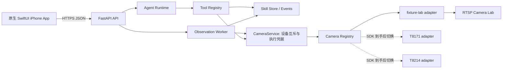

# EvidenceGuard 技术架构

## 纵向链路

原生 iPhone App 不直接依赖摄像头厂商 API。Camera Registry 输出设备能力清单和统一 FrameRef；Worker 只处理新鲜度、设备/通道身份、视角版本和证据。这样 SDK 的 P2P、云端、HomeBase 或局域网差异被限制在适配器内。

## Skill 状态模型

- `status`：`draft / active / paused / stopped / completed`，表示任务生命周期。
- `result`：`initializing / confirmed / needs_attention / unknown`，表示最近一次可解释结果。
- `alert`：`none / open / acknowledged / resolved`，表示告警处理进度。

三者分开保存。目标离区只打开告警，不结束持续任务；重新检查先回到 `unknown`，拿到新证据后才确认恢复。

## Harness 参考

2026-10-12 对照已安装的 MiiMiao v1.0 对照版源码 `c225f46465aaadf460bfc5e736a648192205323e`（Codex 0.153.4）。桌面端由 MiiMiao 管理上下文和权限，由 Codex 执行；它不是已经完成的 Personal Agent。手机云端本次增加冻结的 ExecutionContract、工具权限复核、18,000 字符历史窗口和已确认的用户上下文快照。当前执行器仍是 `bounded-chat-v1`；尚未接入 Codex 二进制或 App Server，不能把本次改动表述为完整移植。

工具包括：

- `list_camera_capabilities`
- `request_camera_snapshot`
- `draft_visual_skill`
- `list_tasks`
- `get_task_state`
- `search_recordings`（Embedding 召回、Lite 视频复核）
- `search_evidence`
- `read_stored_image`
- `request_recheck`

每次 Agent 请求持久化为 run，记录 `run_queued → run_started → model_started → tool_started → tool_completed/failed → response_completed` 等有序事件。Provider 通过配置的 OpenAI-compatible Chat Completions 接口调用当前配置的方舟 Lite。单次运行最多 8 轮，实时对话最多 3 个、历史分析最多 2 个并发，支持取消、超时、请求 ID 去重与重启中断标记。工具只能生成待确认草案，不能代替用户启用任务。历史模式的工具注册表只有 `search_evidence / read_stored_image / search_recordings`，即使模型请求其他工具也会被拒绝。

App 每个标签使用独立 NavigationStack，AI 标签直接显示对话与底部输入框；详情复用对话组件并带任务上下文。语音使用 Apple Speech 转写，用户编辑确认后才发送。

## Personal Agent 与手机演示

手机输入或已确认偏好 → Personal Context 快照 → Harness 执行合同 → 受限工具 → Skill 草案或已存录像查询 → 执行回执。Skill 正式启用仍走用户确认、能力检查、试跑验收和摄像头占用检查。

事件、定时和未处理事项跟进由云端 `PersonalAgent` 每 30 s 检查一次，写入持久化的应用内提醒箱；这是提醒调度频率，不改变摄像头最低 3 s 的检测规则。当前三个 recipe 只读取任务事实，不调用模型或操作设备。后续通用编排应由 Personal Agent 产出受限计划，再经过 Harness 审核权限和执行，不把记忆当成权限。

本次手机内部包自动连接专用演示服务。真实模型 Key 仅保留在云端。演示、原团队服务及 Apple 审核服务使用不同数据库与访问令牌；后两者未替换。详见 [手机演示与 Personal Agent](../Docs/MOBILE-DEMO-PERSONAL-AGENT.md)。

## 下一阶段替换点

1. 官方 SDK 的配网、绑定、持续采集或云端事件能力需实物与账号验收；当前原生 SDK 桥接已有设备发现、事件查询、缩略图。
2. 云端继续守护所需的媒体入口不能依赖 iPhone 始终前台运行。确认官方云事件 / 网关路径后再接 CameraService。
3. 先验证当前模型服务与 Codex App Server 的协议适配，再迁移执行器；保留取消、幂等、工具范围与回执语义。
4. 接入 APNs，把云端提醒送到后台手机。多用户发布前补齐真实账号、设备所有权和租户隔离。

## v0.3 联动更新

加入按任务限定的工具上下文、实际新图请求与回执、TaskEnvelope 工作负载限流、语义状态转换 checkpoint、告警 episode 去重及独立图片持久化。具体范围、验收和剩余边界见 [v0.3 记录](../Docs/SKILL-RUNTIME-v0.3.md)。

## v0.4 摄像头占用

每台物理设备（包含其全部通道）只有一个 active Skill。SQLite `BEGIN IMMEDIATE` 使检查冲突、暂停占用任务、启用目标任务成为一次原子提交。多摄像头任务同时占用全部绑定设备。每次启用/恢复生成新的 executionEpoch；App 切换确认携带所见占用任务的 epoch，状态变化时重新确认。CameraService 使用每设备异步锁让旧命令结束后再切换，排队请求执行前与回执入库前校验 epoch。当前是单服务进程实现，不是分布式设备租约。

实时助手查看画面沿用当前守护的所有权；历史 run 只读取 SQLite 中的不可变证据及持久化图片。缓存读取不得触发设备操作，后续 SDK 的 `state / frame_bytes` 必须遵守此约束。详情见 [v0.4](../Docs/CAMERA-OWNERSHIP-v0.4.md)。

## v0.5 历史视频

VideoService 将本地原录像转为可播放副本与重叠片段，VideoStore 保存源信息、片段范围、模型签名和向量。Agent 通过 search_recordings 检索并复核候选，不触达设备层。API 支持范围播放，SwiftUI 证据卡传递原片时间给 AVPlayer。当前是 SQLite 精确余弦检索，尚非大规模视频索引。完整实现、测试结果与模型效果边界见 [v0.5](../Docs/VIDEO-HISTORY-v0.5.md)。

## v0.6 查询范围与可核验结果

App 传 HistoryFilter，Runtime 将其解析并持久化为固定 HistoryScope，由工具层强制执行；模型只能提出查询内容。VideoService 通过回调写入持久化阶段事件，历史查询仅使用当前工具回执生成摘要并关联卡片。视觉 Provider 的失败单独标记，不与遮挡混淆。回归脚本独立评测分类、定位、失败和耗时，保留人工描述审核以及缺失场景。详见 [v0.6](../Docs/VIDEO-RELIABILITY-v0.6.md)。
