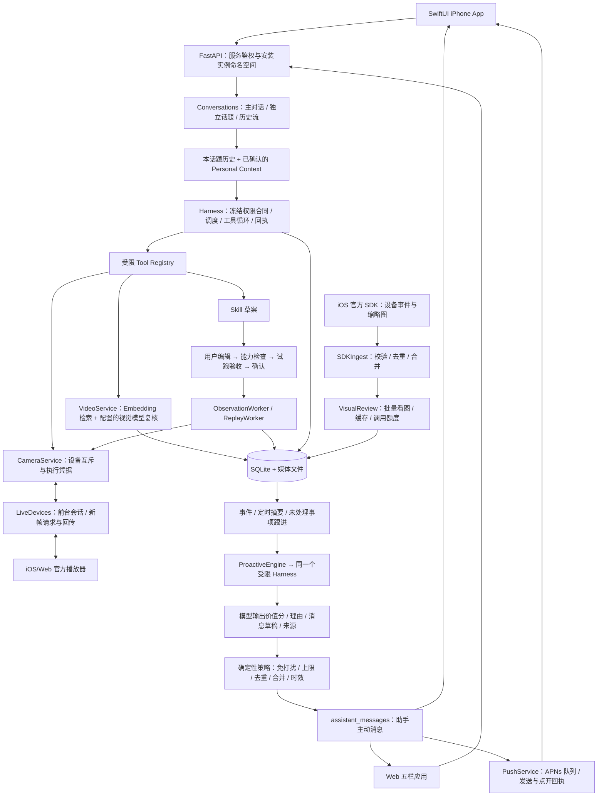

# EvidenceGuard 当前后端与对话架构

源码核对日期：2026-10-14，`dongrunze`。本文包含 Web 0.2、前台媒体中转与 APNs 的代码能力；本轮源码修订不代表线上服务或 TestFlight 已更新。部署与构建状态分别查看服务器和 TestFlight 文档，早期版本记录保留在文末。

## 1. 当前部署形态与职责

一个 Python / FastAPI ASGI 进程包含 API、Harness、后台观察、视觉核验、主动提醒。队列是进程内 asyncio，任务、回执、去重信息持久化在 SQLite；录像文件落在服务磁盘。不是多个独立微服务，也不是每位用户一台独立 VM。

API Token 在云端服务接入层验证；模型 Key 只在云端。当前安装 ID 是内部演示的命名空间，不是正式用户身份认证。摄像头、Skill、证据仍属于演示家庭共享数据；会话目录和主动提醒按安装实例隔离，尚未完成生产级多租户设备授权。

## 2. 对话入口，本轮已实现

原来 App 只保存一个固定的 generalConversation；没有独立会话目录。顶部“新建草案”实际创建 Skill，不能开始新聊天。

现在使用“长期主对话 + 独立话题”：

- 助手主对话保留原 ID、旧消息和主动提醒，不因新建聊天而换绑。
- 新对话入口创建独立 topic ID，在“助手”中切换到空白话题；第一条用户消息作为默认标题，不额外调用模型。
- 左上角会话列表：主对话置顶、独立话题按最近活动排序，支持标题/摘要搜索、重命名、继续对话。
- 每段话题分别保存聊天记录；切换保留未发送草稿。会话 ID、草稿、模式和未确认发送请求在手机持久化，并按服务 origin 隔离；重开 App 可恢复，只有确认服务器已接收后才清理请求。相同内容及范围重试复用 requestId，修改内容则产生新请求。
- 同一话题的“实时守护 / 历史回顾”对应独立工具作用域和独立 transcript 流；历史流带 `-history` 后缀，列表只展示一个话题。切换或重开话题时恢复持久化的模式选择。
- 新话题不会停止 Skill、不清空用户确认的偏好与记忆，也不会把前一个话题的聊天正文加入新话题上下文。它不是无痕模式；共享家庭事实仍可通过受限工具查询。
- 一个对话流同时只能有一个 run；可以切换到其他话题继续工作。切换页面不等于取消后台 run，取消需要点“停止本次回复”。
- 两端助手草案卡可继续设置；“任务 → 草案详情 → 继续设置守护”进入“对象 / 条件 / 确认”。“摄像头 Skill”提供设备、圈选守护与录像入口。保存草案不启用。

API：

| 方法与路径 | 行为 |
|---|---|
| `PUT /api/personal/conversation` | 注册固定助手主对话，不能被独立话题替换 |
| `POST /api/agent/conversations/main` | 按安装标识幂等恢复/创建主会话，保留旧 iOS 绑定，无需传会话 ID |
| `GET /api/agent/conversations` | 当前安装实例的会话目录、标题、摘要、运行状态 |
| `POST /api/agent/conversations` | 用 requestId 幂等创建独立话题 |
| `PATCH /api/agent/conversations/{id}` | 重命名独立话题 |
| `GET /api/agent/conversations/{id}` | 读取该会话流中的 runs |
| `POST /api/agent/runs` | 发起一次对话执行 |

新目录在 `conversations.py`，原记录仍在 `runs` 表；迁移不清空旧主对话。新话题及其 history 流均校验所属安装实例。历史 Skill / 证据详情对话仍使用原有入口，不在本轮目录中批量迁移。

## 3. Harness、Personal Agent、Skill 的实际顺序

用户发送消息 → 会话查找 → 加入该话题最近历史与已确认记忆 → 冻结 ExecutionContract → TaskScheduler 入队 → 模型提出工具调用 → 注册表校验参数与权限 → 执行工具 → 保存回执 → 返回回答或草案。

- `ExecutionContract`：固化工具白名单、摄像头、Skill、实时/历史范围；模型、记忆和图中文字不能扩权。
- `AgentRuntime`：当前执行器是 `bounded-chat-v1`，最多 8 轮；历史上下文最多最近 16 次 run、总计 18,000 字符。具备超时、取消、请求 ID 幂等、持久化事件与重启中断标记。
- `TaskScheduler`：进程内总容量 24；实时对话并发 3，历史 2，观察 1，摄像头请求 2，主动分析 1。
- `Tool Registry`：查询设备/任务/证据、读取图片、检索录像、取新图、起草 Skill、请求复核。历史模式仅开放 search_evidence / read_stored_image / search_recordings。主动模式仅开放 read_proactive_context / read_observation_image。
- `Skill`：受约束配置，不是生成出的新程序。草案还要编辑对象、区域、条件，经过能力检查、试跑与人工核验才允许适用范围内的执行；真机部署验收未完成不能冒充已发布。
- `CameraService`：按物理设备互斥，并以 executionEpoch 复核旧任务是否过期；一个摄像头只能有一个 active 实时 Skill。历史分析不取得摄像头执行权。
- 产品入口说明在 `harness/runtime.py` 的 `PRODUCT_GUIDANCE` 中供普通/主动对话共用；工具描述与草案摘要同步更新。对话没有平台字段，不能拿媒体采集端的 `platform` 推断用户正在使用的界面。

本项目借鉴 MiiMiao 的上下文、冻结权限、任务封装和可追踪执行。此前对照版本为 `c225f46465aaadf460bfc5e736a648192205323e`（Codex 0.153.4）；本轮没有重新审计桌面仓库最新提交。手机云端没有运行 Codex 二进制或 App Server，不能声称完整移植了桌面 Harness。

## 4. 摄像头事件与主动提醒

官方 SDK 在 iOS 内，通过桥接查询设备/事件并获取事件缩略图。手机上传后，SDKIngest 校验设备、事件、时间、图片来源，去重持久化；不把 SDK 缩略图当作刚拍的新图。

- 设备结构化事件用代码分类，无图或未知类型先保存，不每条都调用模型。
- 同摄像头、同类型按 10 s 时间桶合并，等新增内容稳定后核验。最多取 3 张实际图片合成一次视觉调用。
- 自动视觉核验当前上限：每摄像头每天 100 次（UTC），同一事件最多 2 次尝试；失败也消耗预算，重复结果走缓存。它是成本保护，不是检测准确率的证明，也不是手动聊天全部调用的统一预算。
- 已核验且在时效内的事件、已有任务告警、定时摘要、未处理事项跟进进入 ProactiveEngine。当前为明确的有限触发规则，尚非任意目标的自主计划生成器。
- 模型输出 valueScore / reason / 来源 / 消息草稿。普通主动事项低于 50 静默，50–79 进入摘要候选，80 及以上也要通过确定性策略。用户单独订阅的每日概况允许 50 及以上的有用汇总，仍受免打扰、频率、来源和当前状态检查约束；低价值空概况也可静默。汇总附带原始证据及视觉回执，不只传上次模型草稿。
- 代码决定最终投递：已开启、当前事实仍有效、来源可核验、免打扰、每日最多 6 条新主动消息、最短 300 s 间隔、同类 600 s 内合并。模型不能选择推送时间或绕过这些规则。
- 消息单独写 assistant_messages，不伪造一条用户消息来启动对话。App 主对话合并显示，支持已读、已处理、忽略、1 小时后再看。
- 两端均通过主助手对话显示应用内提醒；iOS 另接 APNs 注册、持久队列、测试发送与点开回执，需用户授权和服务端配置，Apple 接受不代表手机已展示。Web 没有 Web Push，关闭网页后不提供系统通知。接口和投递策略见 [APNs](../Docs/APNS.md)。

这些分值是演示的产品策略起点，尚未做真实安防场景校准。视觉“是否可靠”、任务“是否满足条件”、消息“是否值得打扰”是三种判断，不能把 80 分理解为“事件有 80% 概率发生”。

实时 Skill 仍按秒抽样：最小 3 s，默认确认跨度 6 s，且不得小于采样间隔。iOS/Web 已有前台直播新帧回传，但官方事件缩略图上传、前台单次观察和真机持续执行是不同链路；`publish` 当前始终返回未就绪。客户端取样时间不是设备传感器时间。详见 [实时接入](../Docs/LIVE-DEVICE-INTEGRATION.md)。

## 5. 记忆与录像

- Personal Context：用户明确保存的偏好/长期记忆/临时上下文，带来源和到期控制；聊天窗口属于短期上下文。还没有自动从所有聊天构建可靠的长期记忆，也不推断用户情绪为事实。
- VideoService：上传 → 可播放副本和分段 → Embedding → SQLite 中向量精确余弦检索 → 配置的视觉模型复核候选 → 证据卡定位原片秒数。iOS/Web 都能上传录像；设备 SD 卡/官方云录像自动导入仍未实现。
- 模型名称由 `EG_MODEL_*`、`EG_VIDEO_*`、`EG_EMBED_*` 决定，实际标识由 `/api/bootstrap` 返回。官方 Demo 独立使用固定 Nova Pro 网关。图片核验同时服务事件图片与直播取样；系统提示词仍在源码中，没有提示词管理 API。
- 日历、Gmail、飞书尚未接入。未来结构化数据直接解析；邮件/消息先白名单、关键词、@ 等规则筛选，批量抽取，复用上述确定性提醒策略。

## 6. 当前边界与下一步

1. Web 与 Cloud 需一起更新；旧服务没有 `/api/agent/conversations/main`。历史部署结果不能替代本分支验收，iOS 构建上传状态见 [TestFlight 记录](../Docs/TESTFLIGHT.md)。
2. 官方设备账号、摄像头实物与全天媒体入口仍需联调。iOS 可切换官方工作区完成其配网/绑定流程；保存 SN 和 Cloud 设备登记不能代替真实绑定。前台事件同步、iOS/Web 采集不能保证客户端关闭后继续接收新画面。
3. 当前是一个内部演示家庭的数据模型。正式多人使用前补账号身份、设备所有权、租户隔离、分页、媒体保留策略和独立任务工作进程。
4. 新版原生 UI 需安装对应 iOS 构建；云端部署不会自动更新手机界面。Web 有编辑与试跑页面也不等于真机持续 Skill 已可发布。

## 7. 手机交互参考

- [Muse 官方设计说明](https://introducing.muse.ai/)：长期主聊天、独立 side chats、主动消息、活动记录和确定性确认卡。采用会话组织原则，没有复制其 VM 或完整自主执行能力。
- [ChatGPT iOS 历史列表](https://help.openai.com/en/articles/8980299-how-can-i-view-my-conversation-history-in-the-ios-app)：左上菜单进入最近对话并继续聊，参考为本 App 的会话列表。
- [Claude iOS 快捷入口](https://support.claude.com/en/articles/10263469-use-claude-app-intents-shortcuts-and-widgets-on-ios)：将新对话、语音、拍照作为明确不同的操作。本轮把“新聊天”和“创建 Skill”分开；未实现 Widgets / App Intents。

## 早期实现记录

2026-10-12 阶段验证：138 项云端回归通过；当时尚未部署。2026-10-13 最新回归与部署结果见 [手机演示记录](../Docs/MOBILE-DEMO-PERSONAL-AGENT.md)。

以下为此前各阶段设计记录；当前能力与边界以上文为准。

## v0.3 联动更新

加入按任务限定的工具上下文、实际新图请求与回执、TaskEnvelope 工作负载限流、语义状态转换 checkpoint、告警 episode 去重及独立图片持久化。具体范围、验收和剩余边界见 [v0.3 记录](../Docs/SKILL-RUNTIME-v0.3.md)。

## v0.4 摄像头占用

每台物理设备（包含其全部通道）只有一个 active Skill。SQLite `BEGIN IMMEDIATE` 使检查冲突、暂停占用任务、启用目标任务成为一次原子提交。多摄像头任务同时占用全部绑定设备。每次启用/恢复生成新的 executionEpoch；App 切换确认携带所见占用任务的 epoch，状态变化时重新确认。CameraService 使用每设备异步锁让旧命令结束后再切换，排队请求执行前与回执入库前校验 epoch。当前是单服务进程实现，不是分布式设备租约。

实时助手查看画面沿用当前守护的所有权；历史 run 只读取 SQLite 中的不可变证据及持久化图片。缓存读取不得触发设备操作，后续 SDK 的 `state / frame_bytes` 必须遵守此约束。详情见 [v0.4](../Docs/CAMERA-OWNERSHIP-v0.4.md)。

## v0.5 历史视频

VideoService 将本地原录像转为可播放副本与重叠片段，VideoStore 保存源信息、片段范围、模型签名和向量。Agent 通过 search_recordings 检索并复核候选，不触达设备层。API 支持范围播放，SwiftUI 证据卡传递原片时间给 AVPlayer。当前是 SQLite 精确余弦检索，尚非大规模视频索引。完整实现、测试结果与模型效果边界见 [v0.5](../Docs/VIDEO-HISTORY-v0.5.md)。

## v0.6 查询范围与可核验结果

App 传 HistoryFilter，Runtime 将其解析并持久化为固定 HistoryScope，由工具层强制执行；模型只能提出查询内容。VideoService 通过回调写入持久化阶段事件，历史查询仅使用当前工具回执生成摘要并关联卡片。视觉 Provider 的失败单独标记，不与遮挡混淆。回归脚本独立评测分类、定位、失败和耗时，保留人工描述审核以及缺失场景。详见 [v0.6](../Docs/VIDEO-RELIABILITY-v0.6.md)。
