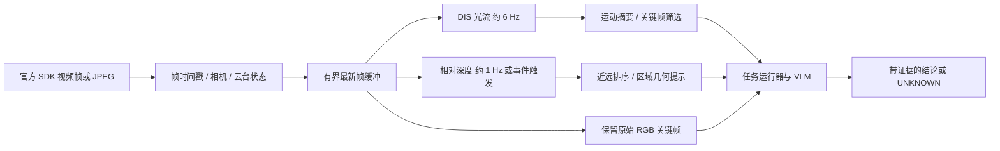

# EvidenceGuard 本机视觉资源测试

用本机 WSL 运行 CPU 深度模型和传统光流，先验证“小服务器预算下能不能跑”，再决定接入 Agent 的方式。这是独立的实验工具目录；测试结果尚未接入 App 或后端在线处理。

**已完成结果：[2026-10-14 首轮实测](results/local-20261014/REPORT.md)。**

三份实测 ONNX 权重已通过本私有仓库的 Git LFS 保存。队友先按 [模型下载与校验](models/README.md) 取回权重；来源、固定版本、SHA256 与上游许可证说明一起保留。报告、逐帧 CSV/JSON 和预览图随代码保存；原视频、抽帧输入、`.npy` 及运行日志未提交。

## 1. 光流到底需不需要模型

| 处理任务 | 必要输入 | 是否需要神经网络模型 | 本次实现 |
|---|---|---|---|
| 视频取帧 / JPEG 编码 | 一段视频或已解码视频帧 | 不需要 | OpenCV 脚本；实机也可使用官方 SDK 帧接口 |
| 普通单张 RGB 估计相对深度 | 一张 RGB | 本方案需要 | ONNX Runtime CPU + 深度模型 |
| 相机直接输出深度 | 硬件深度或经过标定的双目等输入 | 不一定需要 | 本次未验证官方硬件支持，不能假定 RGB 安防设备能直接输出深度 |
| DIS / Farneback 光流 | 同一相机、按时间排序的两帧 | **不需要训练或加载神经网络权重** | 两种算法均已运行 |
| RAFT 等学习型光流 | 按时间排序的两帧 | 需要预训练模型 | 本次未运行，暂不作为小服务器默认方案 |
| “这是孩子/宠物/割草机器人，它发生了什么” | 画面、时间信息、任务上下文 | 通常还需要检测/跟踪/VLM | 光流与深度只提供辅助信息 |

单张图片没有时间变化信息，不能计算观察意义上的光流；视频本质上提供了连续图片。光流应先在连续 RGB 的灰度图上计算，不要求先生成深度，也不建议先对逐帧归一化的彩色深度图做光流。输出 `flow[y,x]=(dx,dy)` 的单位是“这对帧之间的像素位移”，必须同时保存时间差；除以时间得到的仍是像素/秒，不是米/秒。

## 2. 测试环境及可比较范围

目标服务器配置来自团队仓库的 `Docs/SERVER-ACCESS.md`：EC2 t3.medium，2 vCPU、4 GiB、无 GPU；其他应用也使用这台服务器。

| 档位 | CPU quota | 内存硬上限 | Swap | 用途 |
|---|---:|---:|---:|---|
| `server-budget` | 200%（约 2 核计算时间） | 4 GiB | 0 | 观察占用整机预算时的上限 |
| `worker-budget` | 100%（约 1 核计算时间） | 2 GiB | 0 | 视觉进程先给其他服务留出额度 |
| 组合回放 | 100% | 2 GiB | 0 | 1 Hz 深度 + 6 Hz 光流，同时调度 |

本机 i9-14900HX 与云端 CPU 不同，WSL 的 CPU quota 只能限制 CPU 时间，不能复制 EC2 的指令性能、网络、磁盘、邻居负载和积分机制。t3.medium 的 CPU 基线为每个 vCPU 20%；本实验的 2 核档位更接近有可用积分时的额度，不代表无限期可免费保持该吞吐。后续仍需在实际服务器上做同一套复测。[AWS T3 官方说明](https://aws.amazon.com/ec2/instance-types/t3/)

执行时使用现有 WSL Ubuntu-24.04 的 systemd 临时服务，只限制测试进程组；不修改全局 WSL 配置。每个进程检查实际 `cpu.max`、`memory.max`、`memory.swap.max`，不满足配置即停止。CPUExecutionProvider 强制使用 CPU，OpenCL 禁用。线程分别限制为 2/1。所有模型逐个运行，防止多个基准争抢配额。

## 3. 模型、输入与测量方法

- **DepthART MobileNetV4-M-slim-SPF**：作者提供的 224 和 448 标准算子 ONNX，每份约 24.2 MB。遵循官方示例，RGB 转换、正方形 cubic 缩放、ImageNet 归一化。没有使用需要 CUDA 自定义算子的 TinyViM 路线。[官方项目](https://github.com/xuefeng-cvr/DepthART) · [权重](https://huggingface.co/Fengxue93/DepthART)
- **Depth Anything V2 Small FP32**：`onnx-community` 转换版约 99.1 MB；按该版本 HF 预处理配置保留宽高比、尺寸对齐 14、PIL bicubic。854×480 输入在本实验变为 924×518。它与 DepthART 的像素数、架构不同，速度差不能直接解释为同等精度下的优势。[社区 ONNX](https://huggingface.co/onnx-community/depth-anything-v2-small) · [原项目](https://github.com/DepthAnything/Depth-Anything-V2)
- **DIS FAST / Farneback**：输入 640×360 灰度帧；每秒取 6 帧，相邻采样帧间隔约 167 ms。[OpenCV DIS](https://docs.opencv.org/4.x/de/d4f/classcv_1_1DISOpticalFlow.html) · [Farneback API](https://docs.opencv.org/4.x/dc/d6b/group__video__track.html)

模型固定到 commit revision，下载后 SHA256 与上游 LFS 元数据核对，记录于 `models/manifest.json`；未执行仓库远端 Python 代码。DepthART 原创材料为 CC BY 4.0，但第三方材料另有许可，官方也列出训练教师的限制；这里作为比赛研究候选，产品采用前需核对完整权重与第三方许可。[DepthART 许可](https://github.com/xuefeng-cvr/DepthART/blob/main/LICENSE)

用户视频为 1708×480、24 fps、19 秒。左半边已有深度效果，右半边是 RGB。本次只用 `crop=854:480:854:0` 的右侧画面，生成 114 张 JPEG 95 质量样本；深度在全片均匀取 19 张，光流处理 113 对。左侧深度既不是输入，也不是准确率真值。

每个深度/光流测试在独立进程中运行，模型预热 2 次。分别记录解码、预处理、推理、后处理、P50/P95、峰值 RSS、CPU 时间、cgroup 内存/OOM/节流统计。报告的流水线时延不含模型加载、H264 取流解码、网络、绘图存盘、VLM 和排队。原始深度以模型输出分辨率保存 `.npy`；放大、分位数着色只用于预览，不能用预览颜色做米制测距。

除了单项测试，还运行 60 秒单路定时回放：DepthART 448 每秒 1 次，DIS 每秒 6 次，处理过慢就跳过过期时隙；记录丢帧、结果年龄、CPU 和内存。它是短时可行性检查，不是长期稳定性或多路服务器容量测试。

## 4. 重跑方式

当前本机已安装依赖、下载权重并完成首轮测试。正常重跑只需在 PowerShell 进入本目录后执行：

```powershell
.\Run-Lab.ps1 -Video "$env:USERPROFILE\Downloads\compare-input-output.mp4" -Crop right-half
```

新拍的普通摄像头视频应使用完整画面，不要裁右半边：

```powershell
.\Run-Lab.ps1 -Video 'C:\path\camera-test.mp4' -Crop full
```

每次使用新的时间戳结果目录。第一次需要联网安装公共依赖；权重可从 Git LFS 取回，或由准备脚本按固定版本从 Hugging Face 下载约 148 MB。权重已在本机且与随库清单的 SHA256 相符时，不再联网检查模型。测试阶段不调用云模型，输入视频由运行者本机提供。

当前 WSL 默认用户是 root，因此可以创建 systemd 临时服务。换机器时需要 Linux/systemd、Python venv，以及运行临时资源限额服务的权限。WSL 的独立 venv 位于 `~/.cache/evidenceguard-vision-lab/venv`，没有更改 Windows Conda 或后端的 Python 环境。只想在 Linux/未来服务器手动重跑时：

```bash
bash setup_wsl.sh
python3 prepare_models.py
~/.cache/evidenceguard-vision-lab/venv/bin/python prepare_input.py /path/video.mp4 --crop full --sample-fps 6
bash run_bench.sh my-new-run
bash run_sustained.sh my-new-run 60
~/.cache/evidenceguard-vision-lab/venv/bin/python report.py my-new-run
```

命令在本目录执行。不要把上述测试直接部署到正在承载比赛业务的服务器；需要复测时给测试进程分配独立配额。`requirements-resolved.txt` 保存了本次全部依赖版本，`requirements.txt` 固定了主要依赖。

## 5. 对我们 Agent 的接入建议



初始使用 DIS + DepthART 448 低频处理；若负载吃紧，降深度频率或用 224。深度、光流从同一 RGB 推导，不能当作两路独立证据提高置信度。保留原图；VLM 是否受益需要相同场景的对照实验。

实机接入保留 `camera_id`、`frame_id`、帧时间、接收时间、`pair_dt_ms`、分辨率/ROI 变换、`ptz_moving`、深度类型与模型版本。光流结果记录像素位移，深度注明 `relative`；没有米制标定时，接口不提供 `distance_m`。镜头切换、时间断档、云台移动、曝光突变、大片遮挡需要清空前一帧或降低判定有效性。

| 业务场景 | 深度/光流可辅助 | 必须另外核验 |
|---|---|---|
| 庭院孩子活动与摄像头跟随 | 选运动片段、辅助相对近远、短时目标运动 | 孩子身份/目标跟踪、云台引入的背景运动、失去可见性；不能直接判定安全 |
| 草地割草机器人 | 移动/停顿线索、相对前后遮挡关系 | 草叶运动与车体分离、轨迹/禁入区、真实距离；不能据运动推断刀片已停止 |
| 室内宠物/物品 | 活动片段、物品位置变化线索 | 遮挡、镜面、光照、人经过；物品离开需时序证据 |
| 门前包裹 | 出现/移动/离开候选片段 | 投影、取件身份、遮挡；UNKNOWN 单独保留 |

下一步测试集至少分别包含固定镜头、云台转动、近距离遮挡和弱光，记录真实业务判断的误报/漏报及证据新鲜度。当前机器人样例只用于跑通和粗测资源，不能代表这些业务场景的准确度。

## 6. 文件说明

- `Run-Lab.ps1`：Windows 一键准备、两档基准、组合回放和报告。
- `setup_wsl.sh`：独立 Linux Python 环境。
- `prepare_models.py` / `verify_models.py` / `prepare_input.py`：固定权重、上游或离线哈希校验、视频取帧与明确裁剪。
- `benchmark.py` / `run_bench.sh`：独立进程的资源限额基准与合成平移光流验证。
- `sustained.py` / `run_sustained.sh`：定频组合回放，有界延迟。
- `report.py`：从 JSON 生成实测报告，不填充缺失结果。
- `models/`：Git LFS 模型、固定版本清单与来源/许可；`inputs/`：仅本机的视频样本。
- `results/<批次>/`：本地生成报告、JSON、逐帧 CSV、预览与 `.npy`。随库的 `local-20261014` 批次保留报告、JSON、CSV 和预览，未上传 `.npy`。
