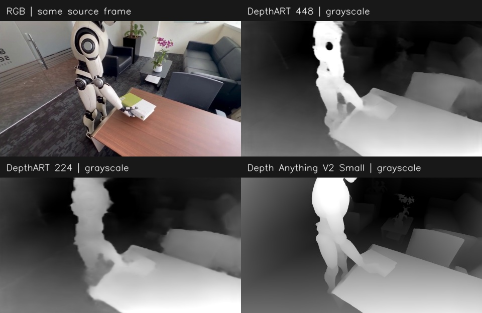

# 2026-10-14：黑白深度与资源测试

[完整性能报告](REPORT.md) · [模型下载](../../models/README.md) · [复现代码](../../README.md) · [全部批次](../README.md)

黑白表示相对远近：近处亮、远处暗；每帧使用 2%–98% 分位归一化。它是深度数值的显示方式，灰度不能直接换算为米。图中三种配置的输入分辨率和模型不同，本图用于直观看效果，没有真实深度真值可据此计算准确率。

## 单张黑白图片

下面是 2 CPU / 4 GiB 档位的三组时刻。PNG 为纯单通道黑白图，打开图片后可从 GitHub 下载原文件。更小资源档位的对应图保留在 `worker-budget/`。

| 模型 | 4.17 秒 | 9.33 秒 | 14.50 秒 | 原图与深度并排 |
|---|---|---|---|---|
| DepthART 224 | [PNG](server-budget/depthart224-224/depth-gray-04.png) | [PNG](server-budget/depthart224-224/depth-gray-09.png) | [PNG](server-budget/depthart224-224/depth-gray-14.png) | [9.33 秒对照](server-budget/depthart224-224/gray-preview-09.jpg) |
| DepthART 448 | [PNG](server-budget/depthart448-448/depth-gray-04.png) | [PNG](server-budget/depthart448-448/depth-gray-09.png) | [PNG](server-budget/depthart448-448/depth-gray-14.png) | [9.33 秒对照](server-budget/depthart448-448/gray-preview-09.jpg) |
| Depth Anything V2 Small | [PNG](server-budget/dav2small-518/depth-gray-04.png) | [PNG](server-budget/dav2small-518/depth-gray-09.png) | [PNG](server-budget/dav2small-518/depth-gray-14.png) | [9.33 秒对照](server-budget/dav2small-518/gray-preview-09.jpg) |

[DIS 光流效果](server-budget/dis/preview-056.jpg) · [Farneback 光流效果](server-budget/farneback/preview-056.jpg)

## 文件如何使用

| 文件或目录 | 内容 |
|---|---|
| `REPORT.md` | 实测结论、性能表、组合回放与未验证项目 |
| `server-budget/` | 2 CPU / 4 GiB 的单项测试 |
| `worker-budget/` | 1 CPU / 2 GiB 的单项测试 |
| `sustained-1cpu-2g/` | 定频组合回放的 JSON 和逐输入时隙 CSV |
| `depth-gray-*.png` | 默认的黑白深度图 |
| `gray-preview-*.jpg` | RGB 与黑白深度并排图 |
| `preview-*.jpg` | 原伪彩色深度或光流预览 |
| `result.json` / `samples.csv` | 汇总环境与逐样本时延，保留原始实测数值 |
| `depth-preview-rendering.json` | 黑白导出规则、对应帧时刻和原始预测 SHA256 |

源视频只有右半边 RGB 被用于推理；左半边原有深度效果未参与计算。原视频、输入帧和 `.npy` 仅保存在本机，模型统一从 `models/` 取回。
