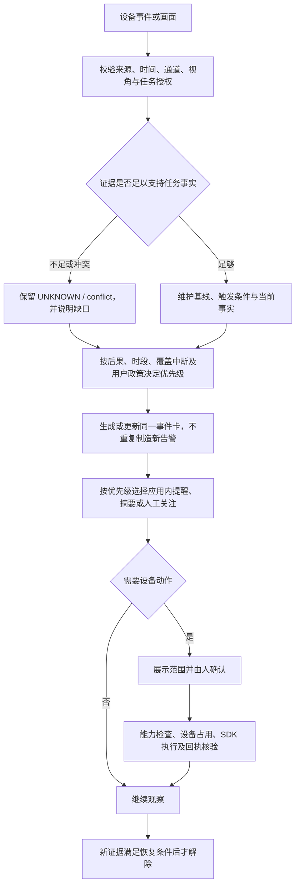

# EvidenceGuard：告警分级与决赛接入方案

版本 v1.2（补全庭院追踪场景）· 2026-10-14 · 无限创新｜EvidenceGuard · 赛道二：智能安防

依据：已提交的预赛方案、官方决赛资料、团队补充的庭院追踪需求，以及仓库提交 `1bf084e`。下文“我们的方案”是待实现的设计；当前完成情况及接入细节放在附录。

## 1. 调研：厂商的告警级别分别代表什么

**最值得借鉴的是海康的做法：用级别表示处理优先级，具体事件由规则配置。** 不同厂商的数字含义不同，不能直接互换。

| 产品／标准 | 原有分级 | 每级对应什么 | 对我们的启发 |
| --- | --- | --- | --- |
| **海康 HikCentral Professional** | 1＝高；2＝中；3＝低；可自定义 | 高、中、低表示处理优先级。某类事件属于哪级，由告警规则指定；该版支持最多 255 个自定义级别。[手册 §9.4.1，印刷页 174][hikcentral] | **按用户任务定义优先级**，不把“有人出现”一律当高危 |
| **大华 DSS Professional V8.1.1** | 高／中／低 | 配置告警优先级；事件类型和处置状态另行表达。[官方手册][dahua] | 将“有多紧急”和“是否处理完”分别记录 |
| **宇视 EZStation 3.0 V1.17** | 1～5 级 | **1** 人工报警；**2** 事件开始或异常，如入侵、离线、物品移除；**3** 设备／磁盘上线；**4** 保留；**5** 事件结束或恢复。[手册印刷页 62][uniview] | 这套编号包含事件开始、上线和恢复，不能当作五档危险程度 |
| **GB/T 28181—2022** | `AlarmPriority` 1～4 | 定义报警优先级字段；事件类型、报警方式另有字段，该字段本身未规定“某种事件固定为几级”。[官方标准信息][gb-info]／[正文镜像 A.2.5.3][gb-pdf] | 保留来源系统的原始等级，再按我们的业务规则解释 |

海康还将优先级、事件类型和确认状态分别呈现。[当前在线文档][hik-alarms] 因此，我们无需把“紧急”“看不清”“已处理”都塞进同一个等级。

补充调研中的“三级 AI 劝离”“热成像预警／报警”“SDK 布防优先级”属于其他概念，放在附录 E，避免与上表混读。厂商版本和适用范围以所引资料为准。

## 2. 我们的方案：持续执行任务，按需提醒

**Agent 承担持续跟拍、作业追踪、物品看护和生活记录。** 例如海外家庭庭院里，用户可以让摄像头跟拍孩子玩耍，也可以让它观察割草机器人的作业过程。正常时继续任务，出现问题再决定是否打扰用户。

下面仍只使用一套处理优先级。P 编号供开发使用，App 以中文名称为主；**优先级控制提醒方式，不决定是否继续跟踪。**

| 处理优先级 | 典型情形 | Agent 应该做什么 |
| --- | --- | --- |
| **尽快处理（P1）** | 孩子进入家长指定的关注区域；割草机器人被观察到越出作业范围；样品或包裹满足约定的异常条件 | 及时提醒，附依据或说明证据缺口，给出下一步；未解决则按约定跟进 |
| **需要关注（P2）** | 跟拍目标短时被遮挡、云台到达极限、机器人可见位置长时间不变、一般设备离线 | 说明当前观察，有限补证；按任务规则决定是否请求人检查或升级提醒 |
| **持续跟踪／记录（P3）** | 孩子在庭院玩耍、割草机器人正常可见地行进、宠物活动、工作时段内正常取物 | 按确认的范围跟拍或观察，保存片段及进展，按需回答追问；通常不立即打断 |

P0“立即人工介入”保留为未来独立紧急响应设计，暂不纳入 MVP 常规分级，也不宣称已具备自动应急处置能力。

**分级由用户确认的任务规则决定。** 正常玩耍、机器人移动和物品搬运本身不触发异常。短时遮挡可以先补证；重要时段跟踪中断超过约定时长，也可直接进入 P1，但仍须写明“无法确认”。等级不要求逐级上升。

### 场景怎么用同一套分级

以下是任务政策示例，阈值和区域由用户确认，实际能力分别验收。

| 场景 | 正常时持续做什么（P3） | 需要关注（P2） | 尽快处理（P1） |
| --- | --- | --- | --- |
| **海外庭院：孩子娱乐跟拍** | 选择本次目标；在确认的取景范围内跟拍玩耍、保存片段，回答“刚才在做什么” | 树木／玩具遮挡、多人交错后目标不确定、到达云台极限；保留最后有效画面并请求补证 | 观察到进入家长标记的泳池边缘／车道关注区域，或跟踪中断超过约定时长；提示家长查看 |
| **庭院草坪：割草机器人追踪** | 选中机器人，持续观察其可见位置、行进片段及停留，回答“现在在哪、刚才怎样移动” | 可见位置持续不变、被灌木遮挡、失去目标；报告现象并复核，不直接判断机器故障 | 观察到越过圈定作业边界，或孩子／宠物进入已约定的机器作业关注区；提示用户介入 |
| **室内：样品／通道看护** | 观察样品位置、通道状态，记录工作时段内正常变化 | 看不清、区域设置需调整，或按任务约定可稍后处理的占用 | 闭店后样品离区，或通道占用达到用户设定的处理条件 |
| **门前：包裹看护** | 持续观察在区状态、记录投递及获授权的正常取件 | 包裹被遮挡，暂不能判断位置 | 新证据满足任务约定的离区提醒条件；不直接推断失窃 |
| **室内外：宠物活动** | 跟随可见活动、保存玩耍片段与摘要 | 暂时不可见或无法持续确认同一目标 | 进入用户指定关注区，或满足事先确认的其他提醒条件 |

孩子跟拍强调片段与可见活动，机器人追踪强调可见位置与作业过程；不能用跟拍成功推出孩子安全，也不能仅凭机器人经过草地就判断已完成割草。设备与边界要求见附录 A4。

### 分级与现有 App 状态如何配合

卡片保留三个信息，分别回答一个问题：

- **优先级：**要多快处理？使用上面的 P1／P2／P3。
- **当前结果：**现在知道什么？沿用预赛的“已确认／需要处理／无法确认”；跟拍和记录任务还需写明“跟踪中／待找回／已暂停／已结束”，并附具体事实和时间。这些是任务进度，不是另一套告警等级。
- **处理进度：**有异常时，区分待处理、已确认收到、已解除；点击“已处理”后仍需新画面复核。正常跟拍不需要人为制造一张待处理告警。

例如，同一张卡片可以这样显示：

> **需要关注｜草坪机器人追踪**
>
> 当前结果：目标被灌木遮挡，当前无法确认位置；最后有效画面为 10:24:08。
>
> 任务进度：待找回。可在已确认的取景范围内补证；需要转动云台时按控制确认规则执行。

重新找到同一目标后，更新原卡片并继续追踪。若中断超过任务允许时长，可提升提醒优先级；UNKNOWN 本身不决定高低等级。

## 3. 从观察到处理的流程



流程图保留原方案。**AI 提取事实并提出建议，程序按任务规则决定分级和权限，人确认重要设备动作。** 同一事件持续更新，避免每张图都新建告警；新证据满足恢复条件后才解除。正常跟拍与作业追踪持续沿“继续观察”运行，没有异常时无需生成或解除告警。

## 4. 与入选方案保持一致

预赛的三项核心能力继续作为主线：

1. **Teach Camera：**一句话＋圈选→生成任务草案→用户确认。可表达“跟拍孩子在庭院玩耍”“帮我看割草机器人是否还在这片草地作业”；草案明确目标、时段、取景范围、提醒条件与失去目标时的策略。
2. **Visual Skill Runtime：**持续维护跟踪和任务状态；不足时保留 UNKNOWN，必要时用有效第二视角补证。找回目标后继续任务；用户点“已处理”触发复核。
3. **Result-first App：**先展示“跟踪中、暂时看不清、需要查看”等具体结果和下一步，再看片段或追问。保留“首页｜Skill｜AI｜证据｜我的”。

**孩子娱乐跟拍、割草机器人追踪是并列的正式业务场景，室内看护和包裹守护也继续保留。** 硬件联调先证明取流、目标保持、云台／停止及新鲜证据能力，各场景分别验收；包裹规则通过不能替代跟拍或机器人追踪通过。

预赛原文已写明孩子／宠物活动记录及按条件跟随取景；本版按团队补充需求，将海外庭院娱乐跟拍和割草机器人追踪具体展开，不将新增细节冒称为原件逐字内容。

海康 2026-09 的 Team Mode V7.0.0 发布说明已介绍自然语言告警规则、预览和带视频依据的连续问答，存在地区及服务条件。[官方说明][hik-ai] 因此，决赛重点应是我们能展示的**持续任务、UNKNOWN、处理后复核和证据追问**，不再用“首次让用户用自然语言教摄像头”作创新结论。

预赛“3 步内创建”“一次追问找到依据”“UNKNOWN 错误闭环目标为 0”继续作为测试目标，不能写成已测得成绩。

---

## 附录 A：两款硬件与三端 SDK

### A1. 云台和门铃的主要区别

下表是官方 App API 的声明能力，实际支持与执行效果仍需真机验收。

| 能力 | T8171 电池云台摄像头 | T8214 电池门铃 | 接入要点 |
| --- | --- | --- | --- |
| 视频、画质、夜视 | 支持 | 支持 | 测媒体输出、时延、休眠及恢复 |
| 云台 PTZ | 支持，先查 `supportsPTZ()` | 不支持 | `startPTZMovement(direction)` 和 `stopPTZMovement(direction)` 均带方向；验证停止回执 |
| AI 追踪开关 | 官方列 AI 自动追踪及 `toggleAITracking(enabled)`，按设备验证 | 不推定有物理跟随能力 | 开关存在不代表支持锁定指定孩子或跟踪割草机器人；需验证类别、选目标和失去目标行为 |
| 预置位／环视 | 有 API，按运行时能力判断 | 不套用云台能力 | 转动后检查 `viewRevision`，旧 ROI 需失效或重新确认 |
| 音频及对讲 | 音量、麦克风设置；手册声明支持对讲 | 门铃音频变体；手册声明支持对讲 | 收音、回传、TTS 注入和全双工分别测试 |
| 快速回复／双摄 | 不套用门铃专属能力 | `sendQuickResponse(voiceId)`、双摄模式 | 预置回复不等于任意 TTS；拼接双摄不等于两台设备 |
| `LightingAPI` | 不支持，返回 `-1002` | 开关、亮度、色温 | 照明、状态 LED 与报警灯分别判断 |
| `StorageAPI` | 支持 | 不支持，返回 `-1002` | 不支持存储管理接口，不代表没有录像或物理存储 |
| 事件、缩略图、设备状态 | 有相关 API | 有相关 API | 图片路径需读取真实字节；历史缩略图不能充当新画面 |

`AlarmType` 的声／光／声光是动作类型，不是风险等级；`HOMEBASE_SOUND` 还要求对应基站条件。报警、转动等控制按赛规由人确认。

### A2. 三端各自承担什么

| 平台 | 官方库与调用路径 | 团队用途 |
| --- | --- | --- |
| Android | AAR＋KMP；初始化 SDK→用户配置→设备发现→物模型就绪→能力查询／调用 | 必要时作为硬件控制的对照探针 |
| iOS | ARM64 KLIB／Framework；SwiftUI→自有 Kotlin Bridge→`SampleCore.framework`→厂商 SDK | 当前主产品；可以把已编译 SDK 当库使用，开发自有 UI 和业务 |
| Web | 独立 JS／React 接口；OpenAPI 鉴权→Provider→媒体会话→播放／抽帧 | 媒体与团队联调；Web 产品开发当前暂缓 |

App 的 Kotlin API 不是可直接粘贴的 Swift 或 JavaScript 接口。iOS 已有真实 SDK 构建及 TestFlight 记录；构建通过不等于真实设备已验收。[自有桥接](../SDK/Bridge/EvidenceGuardSDKBridge.kt)、[TestFlight](TESTFLIGHT.md)

**Web 的准确边界：**1.1.0 包存在 `ptzMove`、`startTallback`（导出名原拼写）、`voiceSpeakerSwitch` 等入口，但 T8171/T8214 在该包中走 `SOLO_CAMERA + MediaChannel`，未继承 PTZ／talkback 能力；PTZ 有型号检查，通用命令层也有跳过该通道发送的分支。结论限定于本批包，不是 Web 技术本身不能控制设备。

Web 媒体配置含音频与视频，播放器有本地音量／静音。能听设备声音、控制设备麦克风、浏览器对讲和注入 TTS 是不同能力，需分别验证。官方允许三种作品形态，但不保证接口完全相同；Web 专项范围与“设备控制＋非视频信息”要求的缺口，需要官方样例、更新包或验收说明。

**物模型（Thing Model）**描述属性、动作和事件，例如电量、Wi-Fi、云台、音频；它不是物理仿真或 AI 权重。当前材料未提供已核实的设备端自定义模型加载接口，先在手机、电脑或云端处理必要图片／片段。

**自由语音对话**还需完整验证“设备收音→ASR→Agent→TTS→设备播放”，以及回声消除、半／全双工、打断、延迟和停止。普通对讲可用，不能直接推定这条链路全部可用。

### A3. 连接与证据入云顺序

1. 取得赛事账号、Token、SN 和正确服务区域；与我们 Cloud 的令牌分开。官方设备通常预先绑定，重配网再用原生流程。
2. 设备侧使用 **2.4 GHz、WPA2-PSK**；本地联调关闭 AP／客户端隔离，确认 DHCP 与联网。同一局域网的 5 GHz 手机通常也可用，设备本身不支持 5 GHz。
3. 建立 SN→型号→逻辑设备→通道映射；等待物模型就绪，记录 `supported/unsupported/unknown`，再开放对应按钮。
4. 验收状态／电量／事件→实际图片→视频／音轨→人工确认后的控制；保存错误码、设备回执和实际效果。
5. 当前 iOS 事件元数据＋实际缩略图可经 SDKIngest 入云核验；持续媒体、命令转发及通用真机执行器还需接通。通过正反例、遮挡、停止和恢复测试后再允许真实 Skill 发布。

证据沿用 [摄像头接入合同](../Cloud/CAMERA-SDK-CONTRACT.md)：设备／通道身份、`capturedAt`、`receivedAt`、来源、新鲜度、`viewRevision` 与时钟误差。接收时间不能冒充拍摄时间；过期图只能说明过去。

现有 `CameraService`／`executionEpoch` 约束同一物理设备只有一个活动实时 Skill，多通道共享占用；外部 Web／App 会话尚未全部纳入统一协调。测试前先停止其他客户端对同一设备的操作，停止失败或迟到回执按合同处理。

### A4. 两类庭院追踪的实现要点

| 要点 | 孩子娱乐跟拍 | 割草机器人追踪 |
| --- | --- | --- |
| 本次目标 | 用户在画面中选定；验证多人交错后能否保持目标，不默认做人脸身份识别 | 用户选定机器；不能因 SDK 有车辆检测就认定支持割草机器人 |
| 摄像头跟随 | T8171 优先验证原生追踪的目标选择能力；不足时才评估自有视觉＋PTZ 闭环 | 验证外形较小、低位移动目标的持续跟踪；原生不支持时，自有识别、取帧频率与控制回路均需开发 |
| 丢失与找回 | 保存最后有效位置／时间；不能随意切到另一名孩子并宣称已找回 | 失去目标时不能解释为已离开草坪或已完成；找回后核验是否同一台机器 |
| 结果范围 | 可见活动、片段和是否进入用户标记区域 | 可见行进／停留、位置变化及是否越界；未接机器遥测前不声称知道电机、刀盘、故障或真实割草完成率 |

**取景与区域必须一起处理。** 云台转动后，泳池边缘、车道和草坪边界不能继续使用旧画面的固定像素 ROI。先验证预置位恢复、区域重定位或场景标定；未完成时只报告可见事实／UNKNOWN，可用固定机位保留边界观察。T8214 可提供固定视角记录或补证，不能代替物理云台跟拍。

**控制与任务范围要明确。** 开启跟拍前展示目标、设备、取景范围、时长及停止入口；持续自动转动的确认粒度须满足赛规并与官方核实，未确认前使用人工控制或固定视角。当前没有割草机器人控制接口，提醒用户检查不等于能自动停机。单台摄像头也不能同时承担两个相互冲突的云台任务，按现有占用规则切换或使用两机分工。

## 附录 B：云端连接与移动办公

### B1. 当前入口

以 [SERVER-ACCESS.md](SERVER-ACCESS.md) 为准：新加坡 `ap-southeast-1`，实例 `i-010907ed19e2cc23a`，固定 IP `47.131.21.137`。手机内部包使用 TestFlight `1.0 (5)`；旧 build 3/4 内置旧美国入口。

| 环境 | HTTPS 入口 | 服务／数据目录 |
| --- | --- | --- |
| 手机演示 | [demo](https://demo.47.131.21.137.sslip.io) | `evidenceguard-demo`／`/var/lib/evidenceguard-demo` |
| 团队联调 | [team](https://team.47.131.21.137.sslip.io) | `evidenceguard`／`/var/lib/evidenceguard` |
| Apple 审核 | [review](https://review.47.131.21.137.sslip.io) | `evidenceguard-review`／`/var/lib/evidenceguard-review` |

三环境分别保存数据和凭证，每环境一个应用进程；当前为 SQLite＋媒体文件。R2 可作为未来对象存储，不是当前数据库的替代品。[后端架构](../Cloud/ARCHITECTURE.md)

2026-10-14 初稿核验时，三个 `/api/health` 均返回 200；这只证明进程在线，没有代替服务器登录、受保护 API 或真实摄像头验收。本次精简未重复测试服务。

### B2. 推荐使用 SSM

Windows：本人 AWS 身份登录→新加坡实例→连接→SSM 会话管理器。标准 SSM 会话无需开放 SSH 入站，也无需反复登记笔记本公网 IP；成员仍需被授予对应 IAM 权限。[AWS 官方说明][aws-ssm]

有 Bash 的终端可在仓库根目录执行：

```bash
bash scripts/cloud_session.sh check YOUR_AWS_PROFILE
bash scripts/cloud_session.sh connect YOUR_AWS_PROFILE
```

需要 AWS CLI v2、本人有效登录；`connect` 还需 Session Manager 插件。实例已有 SSM 角色不等于个人已获授权，`check` 成功也不等于交互登录通过。[接入脚本](../scripts/cloud_session.sh)

- **笔记本换 Wi-Fi／热点：**服务器地址和本机密钥不变，断线后用 SSM 重连；新网络的出口限制仍需检查。
- **继续使用公网 SSH：**来源 IP 白名单可能需要管理员更新。私钥留在本机，管理员配置公钥；本机旧别名 `evidenceguard-cloud` 仍指向已停用的 `34.218.51.85`，尚不是可用的新服务器连接。
- **摄像头换场地：**先解决设备 Wi-Fi 与绑定，再测媒体。设备服务区域按官方凭证配置，不随我们的 AWS 区域一起改动。

本轮未修改 SSH。若后续需要，待分配账户后更新主机、用户名和身份文件；新主机指纹按 [服务器说明](SERVER-ACCESS.md) 核对。

## 附录 C：开发字段与当前完成程度

### C1. 如何接入现有代码

| 字段 | 当前含义／建议 |
| --- | --- |
| `status` | 保留任务生命周期：`draft/active/paused/stopped/completed` |
| `result` | 保留 `confirmed/needs_attention/unknown/initializing`；其中 `confirmed` 表示任务基线／恢复条件已确认，不能直接解释成“异常确认” |
| `alert` | 保留 `none/open/acknowledged/resolved`；确认收到不等于解除 |
| `responsePriority` | 拟新增 P0–P3，按用户确认的任务政策计算；不由模型临时扩权 |
| `taskIntent`、`trackingState` | 拟增任务意图及 `tracking/lost/paused/ended` 进度，表达孩子跟拍、机器人追踪等；不复用告警等级表示“正在跟踪” |
| `evidenceState` | 拟增 `supported/pending/unknown/conflict`，描述对具体结论的证据；不作为另一套风险等级展示 |
| `incidentId`、`sourceGrade`、`policyVersion` | 拟增统一事件编号、厂商原始等级和政策版本；同一事件持续更新 |
| `valueScore` | 现有消息价值分；不能直接映射成 P 级别或事件发生概率 |

代码依据：[Worker](../Cloud/server/evidenceguard/worker.py)、[Store.recheck](../Cloud/server/evidenceguard/store.py)、[Swift 模型](../EvidenceGuard/AppModels.swift)、[ProactiveEngine](../Cloud/server/evidenceguard/proactive.py)。以下契约仅为设计示例，不是现有 API 请求体：

```json
{
  "schemaVersion": "alert-policy-proposal-v1",
  "incidentId": "example-incident-001",
  "skillId": "example-skill-001",
  "taskIntent": "mower_tracking",
  "trackingState": "lost",
  "responsePriority": "P2",
  "priorityReasons": ["作业观察中目标被遮挡，需要补充证据"],
  "evidenceState": "unknown",
  "claim": "最后一次有效画面中机器人位于灌木旁，当前无法确认位置或是否继续作业",
  "taskResult": "unknown",
  "alertState": "open",
  "evidenceRefs": ["example-last-visible-frame", "example-occluded-frame"],
  "sourceGrade": null,
  "policyVersion": "example-policy-v1",
  "nextStep": "请求新画面；需要重新取景时先确认控制范围，找到目标后继续追踪",
  "proposedActions": [
    {"type": "request_recheck", "requiresConfirmation": true}
  ]
}
```

事件实际落地还需时间、设备／通道、证据有效范围、变更记录与动作回执。控制动作先确认、再校验能力与设备占用，执行成功有回执后才写“已执行”。

跟拍任务还需保存目标引用、最后有效观察、允许取景范围、失去目标时限与找回依据。`taskIntent` 和 `trackingState` 是本版拟新增字段；生命周期沿用 `status`，暂停／结束时两者必须一致。跟踪进度卡可以在没有告警时独立存在。

现有普通提醒为：`valueScore < 50` 静默，50–79 进入摘要候选，≥80 进入即时候选；订阅的每日概况可接纳 ≥50。还受免打扰、每天最多 6 条、300 秒间隔、600 秒合并及来源时效检查约束。这些可用于 P3 和普通 P2；**P1 需另定首次提醒、跟进与免打扰例外，不能机械套普通消息限频**。目前只有应用内轮询和角标，没有 APNs 锁屏推送。

### C2. 已有基础与待完成项

| 已有代码／记录 | 仍需开发或验证 |
| --- | --- |
| 原生 App、真实 SDK 构建与 TestFlight 记录 | iPhone 实机媒体、控制、全天持续采集 |
| Cloud 对话、受限工具、录像检索、普通主动提醒 | P 级别策略、统一事件卡、APNs |
| fixture／replay 状态机、UNKNOWN、处理后复核 | 通用真机视觉执行器；两个正式设备端口仍保留 unknown |
| 官方 PTZ／AI 追踪声明与接入合同 | 指定目标保持、孩子／割草机跟拍、遮挡找回、转动后的区域重定位及边界核验 |
| SDK 事件元数据与实际缩略图导入代码 | 官方绑定、真实采集、命令转发及双机补证 |
| 演示环境鉴权与安装实例区分 | 正式成员身份、设备授权与多租户隔离 |

详情见 [后端架构](../Cloud/ARCHITECTURE.md)、[摄像头合同](../Cloud/CAMERA-SDK-CONTRACT.md)、[TestFlight](TESTFLIGHT.md)。编译、模拟器、回放与网页预览成功，都不能替代真机验收。

### C3. 最小验收清单

| 验证项 | 通过标准 |
| --- | --- |
| 孩子庭院娱乐跟拍 | 正常活动持续记录；多人交错不随意换目标；遮挡进入待找回；进入标记关注区时按规则提醒 |
| 割草机器人作业追踪 | 能保持选中机器；区分可见移动、停留、遮挡与越界；不以“经过草地”认定割草完成，不伪造停机控制 |
| 物品在区内→离区 | 先建立基线，再按任务规则触发，前后证据可查 |
| 遮挡、离线、旧图、视角改变 | 保留 UNKNOWN，不误报离区或正常 |
| 已处理→复核→恢复 | 点击不直接关单；操作后的新证据满足条件才解除 |
| 工作时段／闭店时段 | 相同观察按不同任务政策处理；记录和告警不混淆 |
| 双机与多客户端 | 时间和结论冲突时不强行确认；占用、停止及迟到回执正确处理 |
| PTZ、边界与双向音频 | 分别验证跟随／停止、转动后 ROI 重定位、收音／回传／TTS／打断，不以一项成功代替全链路 |
| 重复事件与提醒 | 同一事件合并；分别记录生成、到达 App、已读状态 |
| 室内外迁移与换网络 | 孩子、机器人、室内物品分别跑正反例与 UNKNOWN；SSM 可重连，设备网络单独验收 |

开发顺序：硬件能力回执→后端契约与真实输入→持续跟踪／取景执行器→App 状态与确认卡→各场景独立验收。各端共用 Cloud 契约，保持 iOS 为主产品。比赛仍需展示真实设备控制＋至少一种非视频信息；耗时按采集、入云、核验、提醒到达分别记录。

## 附录 D：材料与版本依据

- **入选原件：**`_【无限创新】预赛材料.Anker首届黑客松挑战赛 .zip`，正文 `【无限创新】预赛材料.Anker首届黑客松挑战赛.md`（20,576 字节）。原件信息卡写“无限创造”，本文按当前约定使用“无限创新”。
- **ZIP SHA-256：**`9554E6FD8AF3FFD7E2E0A076D88688275CCC8F99145CEBA5075FDBC003181CE4`。
- **正文 SHA-256：**`C8C8AC2EF5F3AE082826208411EB74D25D0E8AB21DA4D1C858F003B8E03DF944`，与本机解压件一致。

官方文件均在本机 `安防赛题材料/文档/`，未作为公开附件加入仓库：

| 文件 | 用途／适用范围 |
| --- | --- |
| `赛题规则与准备指南.md` | 三端共同赛规、设备、网络、人确认和交付要求 |
| `app端/SDK开发指南-Android-iOS.md` | App 初始化、工程及运行约束 |
| `app端/API参考手册-Android-iOS.md` | App API、型号差异、签名与错误码 |
| `app端/物模型高阶用法-Android-iOS.md` | App 属性／动作／事件和媒体；不直接通用于 Web |
| `web端/开发指南.md` | Web 鉴权、Provider 和媒体路径 |
| `web端/API参考手册.md` | Web API 摘录，不是全部 bundle 导出 |
| `web端/赛前准备清单.md` | Web 环境、已绑定设备与测试准备 |

既有本机审计：`EvidenceGuard/docs/THREE_PLATFORM_SDK_AUDIT.md`、`THREE_PLATFORM_PROVISIONING_AND_MEDIA.md`，2026-10-07，App 2.2.7／Web 1.1.0。Web 原始文件为 `安防赛题材料/demo工程/WebSDKDemo/public/sdk/index.js`，4,858,053 字节；SHA-256 `316bfc1edb3cf5c35ed24e7fa9fd0caa1867bc111181c9a58348f86dee97f02e`。

`WEB_SDK_STATIC_EVIDENCE.md` 中 E01/E02 为型号，E03 为继承能力，E05 为命令跳过，E09/E17 为能力／PTZ 检查，E11/E12 为音频与播放控制。以上仅证明静态调用路径；SDK 更新后重查，不当作真机通过结果。

## 附录 E：其他“分级”概念，供技术查阅

- **海康 AI 劝离阶段：**L1 预设语音警示→L2 按 AI 观察到的属性针对性劝离→L3 加强警示。这是动作升级，不是危险等级；受设备和服务条件限制。[2026-09 发布说明][hik-ai]
- **海康热成像：**`alert` 预警／`alarm` 报警对应配置的测温阈值，不给本次普通 eufy 摄像头增加测温能力。[协议][hik-thermal]
- **海康 SDK 布防：**`NET_DVR_SETUPALARM_PARAM.byLevel` 的 0／1／2 对应高／中／低，适用于智能交通抓拍设备的连接与上传优先级。[结构体][hik-sdk]

这些资料说明：**处理优先级、动作阶段、触发阈值和通信优先级需要使用各自的名称。** 我们对用户展示的仍只有第 2 节那套处理优先级。

---

本文已按审阅意见整理，发布至 `dongrunze` 分支供团队协作。方案中的拟新增功能仍需实现和验收，发布文档不代表对应能力已经上线。

[hikcentral]: https://enpinfo.hikvision.com/unzip/20200731103027_05278_doc/pdf.pdf
[hik-alarms]: https://enpinfo.hikvision.com/hkwsen/unzip/20260728201022_79073_doc/GUID-76C9D19D-DB84-481F-8F9C-B0CD34199265.html
[hik-ai]: https://enpinfo.hikvision.com/hkwsen/unzip/20260915194932_72332_doc/GUID-9E571E9C-C846-48DD-9757-45AEBF0D7202.html
[hik-thermal]: https://open.hikvision.com/hardware/v2/08%E5%8D%8F%E8%AE%AE%E9%80%8F%E4%BC%A0/%E7%83%AD%E6%88%90%E5%83%8F%E5%8A%9F%E8%83%BD.html
[hik-sdk]: https://open.hikvision.com/hardware/structures/NET_DVR_SETUPALARM_PARAM.html
[uniview]: https://www.uniview.com/us/res/202103/31/20210331_1790096_EZStation%203.0%20User%20Manual-V1.17_788621_168459_0.pdf
[dahua]: https://www.dahuasecurity.com/asset/upload/uploads/soft/20230423/DSS-Professional_Users-Manual_V8.1.1_20230423.pdf
[gb-info]: https://openstd.samr.gov.cn/bzgk/std/newGbInfo?hcno=8BBC2475624A6C31DC34A28052B3923D
[gb-pdf]: https://ossrs.net/lts/zh-cn/assets/files/GBT28181-2022-e617420a7a79d48164835321c4ecc429.pdf#page=93
[aws-ssm]: https://docs.aws.amazon.com/systems-manager/latest/userguide/session-manager.html
