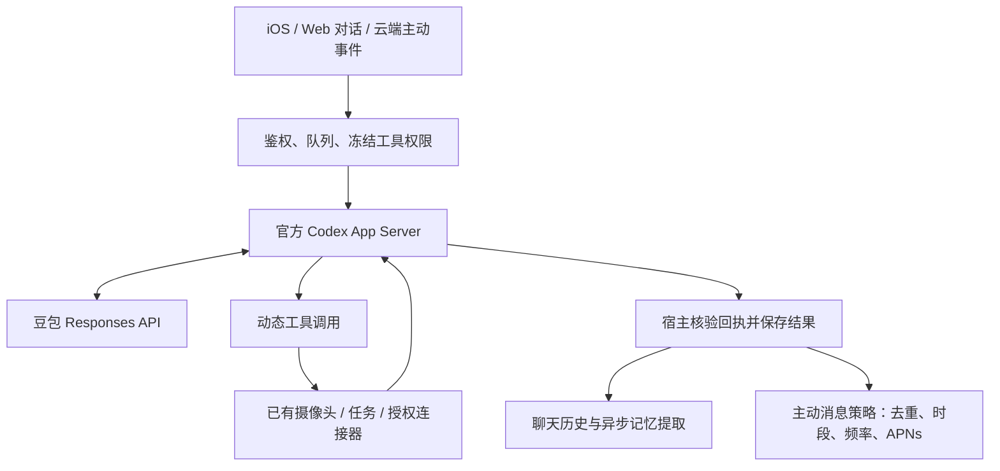

# anker 的云端 Codex 执行器

本文随 `feat/anker-assistant@2cc803e` 的后端同步保留；下方历史验收结果来自该分支记录，不代表本轮重新执行。`dongrunze` 的独立源码核对、测试和实际部署状态以 [demo 联调记录](DEMO-TOOLCHAIN-DEPLOYMENT.md) 为准。

手机后端支持 `EG_AGENT_EXECUTOR=codex-app-server-v1`：使用官方 Codex CLI **0.162.1** 的 App Server 执行多步对话和只读主动评估。模型保持豆包 `doubao-seed-2-1-lite-260915`，通过现有网关的 Responses API 调用。记忆提取、专用视觉核验和 1024 维 Embedding 继续使用原有豆包服务。



## 执行边界

- 每轮创建独立 stdio 进程和 ephemeral thread，结束、失败、超时或取消后关闭进程组并删除工作目录。服务重启后运行中的请求按原有逻辑标记中断，不盲目重放副作用。
- 应用数据库保留聊天、工具回执、记忆和主动任务。每轮只注入该请求已授权的历史和记忆，历史仍保持 user/assistant 角色；不是把手机所有用户接到同一个 Codex 会话。
- Codex 自己驱动 Responses 与工具循环；Python 只将 `item/tool/call` 交给原有作用域和参数校验，并回传结果与图片。没有另外用 Chat Completions 模拟一个名叫 Codex 的循环。
- Chat 最多 8 次宿主交互、主动评估最多 4 次；保留原有总时限。单轮只能创建一份待确认草案，不能自动启用任务。主动评估请求 JSON Schema，并在宿主严格校验；兼容网关若返回整段 JSON 围栏或 Python 数据字面量，只归一化格式，不执行代码、不补全缺失字段。来源核验和是否通知仍由确定性代码负责。
- 关闭 shell、图片文件读取、网页搜索、插件、技能发现、目标自动续跑和子 agent；不继承主机 Codex 登录、MCP、AWS/APNs/应用令牌。未支持的原生交互请求直接失败，不增加权限。
- 出于现有手机服务 800 MiB 内存限制，一次只运行一个 Codex 进程；其余请求仍由已有队列调度。不新增实例。合成图片验证中单个子进程最大 RSS 约 245 MiB，这不是并发容量压测。
- 失败会保存失败状态，不暗中切换模型或旧执行器。`bounded-chat-v1` 是管理员明确设置时的回滚选项，仍使用豆包。

## 部署配置

仅手机服务的私有环境文件设置：

```dotenv
EG_AGENT_EXECUTOR=codex-app-server-v1
EG_CODEX_BINARY=/opt/evidenceguard-codex/0.162.1/codex
EG_CODEX_RUNTIME_DIR=/var/lib/evidenceguard-demo/codex-runs
```

保留现有 `EG_MODEL_BASE_URL`、`EG_MODEL_ID`、`EG_MODEL_API_KEY`。网关必须支持 **Responses 的 SSE、函数调用和 JSON Schema**，仅支持 Chat Completions 不够。不要将凭证写入命令参数、仓库或手机。

Linux x86_64 二进制来自官方 npm 包 `@openai/codex@0.162.1-linux-x64`；下载后按发布元数据的 SHA-512 integrity 核验，再固定安装到上述版本目录。服务器同目录保留 `release.json` 和该版本生成的协议 schema。升级时先做隔离验证，不使用浮动 latest。

运行目录由 `evidenceguard-demo` 用户独占，权限 0700。继续沿用现有 systemd 的 `ProtectSystem=strict`、`NoNewPrivileges=yes`、800 MiB 限制和仅允许写手机数据目录的策略。App Server 通过私有 stdin/stdout 通信，不开放任何公网端口，也不需要另一个常驻 Codex 监听服务。

上线前备份手机源码、配置和一致性 SQLite 快照，检查无正在运行的请求；重启手机服务后检查健康、实际对话、执行事件和三环境隔离。回滚仅恢复原源码和配置后重启，不覆盖上线期间的新用户数据。团队和 Apple 审核服务独立，不能一起改动。

## 验证

- 本地后端 280 项测试通过，包括实际子进程 stdio、早到工具请求、历史角色、图片回执、跨线程/越权拒绝、失败不当作成功、凭证不继承和取消清理。
- 新加坡隔离库、正式服务账号与相同文件权限下，真实豆包验证身份、偏好提取、新对话回忆、两步设备/任务查询、无设备正常问答、不同安装身份的记忆隔离。
- 只读主动评估已通过官方 Codex，结构化评分与已读来源回执有效；合成红色图片已通过动态工具输出送给豆包识别。测试期间关闭 worker 和 APNs，不向用户发送测试通知。
- 这些结果不等于真实摄像头到锁屏通知的验收。官方硬件/凭证、独立于手机前台的云端采集来源和 APNs 送达仍需分别验证；部署 Codex 不会凭空增加摄像头接入能力。

协议依据：[官方 App Server 文档](https://learn.chatgpt.com/docs/app-server)、[官方配置说明](https://learn.chatgpt.com/docs/config-file/config-reference)。

## 早晚报告与记忆验收（2026-10-15）

该分支记录的手机活跃源码为 `/opt/evidenceguard-demo/releases/briefings-20261015/Cloud/server`，由 `70-briefing-runtime.conf` 选择，Codex 版本与豆包模型不变；维护时仍须读取实际 ExecStart。新报告通过同一 Codex 只读评估，事实模板负责证据边界；记忆专用 JSON 请求关闭深度思考并保留持久重试。上线前后检查及公开数据集选题范围见 [该分支的验收记录](https://github.com/zhangmiao03/evidenceguard-ios/blob/2cc803e/Docs/BRIEFINGS-AND-ACCEPTANCE.txt)。
