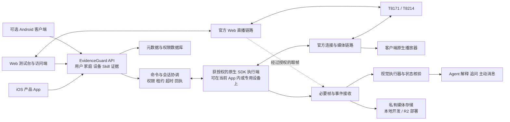

# EvidenceGuard 官方 SDK 接入与产品补全方案

日期：2026-10-14。设计基线：`evidenceguard-ios`，分支 `dongrunze`，提交 `1bf084e2bbde72db90162cfcf6bce89f6a584377`。本文保留当时的实施设计与缺口判断。本轮已推进已绑定设备、前台直播与 Agent 取样链路，具体已实现范围和待验收项见 [实时设备接入](LIVE-DEVICE-INTEGRATION.md)，不表示本文全部里程碑已完成。

主要依据是用户指定的[《三端 SDK 审查覆盖与产品能力缺口》](../../EvidenceGuard/docs/SDK_COVERAGE_AND_PRODUCT_GAPS.md)，并沿用其配网、账号、三端媒体与静态证据文档。当前产品实现情况另以本仓库源码核对：旧 `EvidenceGuard` 目录中的审查结论不能直接代替新 `evidenceguard-ios` 仓库的实现状态。

## 1. 实施结论

保留现有 SwiftUI App、Kotlin SDK 桥接、FastAPI 和 Agent。下一轮开发的中心是把官方设备接入同一条业务链：**成员授权 → 设备注册 → 官方连接 → 媒体会话 → 有来源的观察 → Skill 运行 → 证据与通知同步**。

当前已经有官方设备发现、事件查询、图片读取、事件上传和 AI 图片核验；仍缺少真实配网与绑定、统一设备注册、实时播放器、对讲及云台桥接、成员权限、持续采集执行端。不能把现状描述成“完全没有 SDK 接入”，也不能把事件缩略图上传描述成“已经实时取流并持续守护”。

本轮以 iOS 为产品交付主线，Web 作为团队共享测试台和业务访问端；Android 保持相同业务契约，并作为可选原生执行端。这样符合现有仓库和原先的 iOS 目标，不要求为了补功能同时重写三套完整产品。三端的功能入口可以一致，底层实际由谁执行必须明确。

第一条验收链选“已绑定的 T8171/T8214 → App 显示真实设备 → 打开直播 → 获取当前帧 → 云端返回带来源的回答”。随后完成首次配网、换网、历史录像、多成员同步和守护运行。优先复用官方 SDK 已有能力，避免根据 Demo 页面重新发明设备协议。

## 2. 当前代码到底已有多少

| 领域 | 当前源码中的实现 | 必须补齐的部分 |
|---|---|---|
| 标签识别 | `AddDeviceView` 调用手机相机扫描或手输 SN；`PendingDevice` 存在 UserDefaults | 识别标签之后的型号配置、官方 QR 配网、绑定回执、真实设备导入；保存 SN 不等于绑定 |
| 官方登录与发现 | `OfficialSDKConnection` 和 Kotlin 桥接提供连接、设备发现；凭据保存在 Keychain | 账号切换清理、授权范围、设备注册表同步、连接生命周期与失效恢复 |
| 事件与图片 | 桥接有 `queryEvents`、`readPicture`；`syncEvents` 上传官方事件与缩略图 | 完整分页、按设备同步游标、断线补拉、事件录像导入、后台运行归属 |
| 前台同步 | `OfficialSDKInspectionView` 在该页前台循环查询；每轮完成后等待 30 秒，查询最近 120 秒 | 从调试页面迁出到明确的采集服务；离开页面、锁屏和失联时更新覆盖状态 |
| 后端接收 | `/api/sdk/events` 支持去重、图片保存、合并核验和主动消息输入 | 账号/家庭/设备级权限、统一设备 ID、完整媒体索引、执行端来源验证 |
| 设备抽象 | 已有 `DeviceManifest`、`FrameRef`、`OfficialSDKBridge`、`CameraService`，含时间、通道、视角版本、所有权 epoch 等设计 | 把原生执行端真实接入这些端口；注册表从适配器静态清单变为实际设备清单 |
| 摄像头路由 | 默认 `FixtureLabAdapter`；官方待接入适配器使用 `cam-a`、`cam-b` | 去除生产链路对固定设备 ID 的依赖；支持任意已授权 SN，保留测试适配器用于回归 |
| 真实事件设备 ID | 上传链按 SN 哈希生成 `sdk-…` ID | 与首页、Skill、媒体播放器引用同一个设备记录；不能长期保留两套互不相认的设备身份 |
| 视频 | 已有已导入文件的分析、检索与回放相关能力 | 官方实时媒体会话、真实事件录像下载、录像导入适配；上传视频文件不等于摄像头开流 |
| Agent 与 Skill | 有工具、草案、任务状态、证据、主动消息和所有权校验 | 真实观察源和已验证的视觉执行器；真机发布接口当前明确拒绝发布 |
| 多用户 | 有团队访问令牌和安装 ID 对应的个人上下文 | 正式用户、家庭成员、角色、设备授权、跨安装同步；安装 ID 不能当登录身份 |
| 通知 | 当前主动消息主要进入 App 内消息 | 自研 App 的推送 Token、服务端投递、点击路由、撤权后停止投递 |

代码依据：[添加设备](../EvidenceGuard/AddDeviceView.swift)、[标签解析](../EvidenceGuard/DeviceQRCode.swift)、[官方连接](../EvidenceGuard/OfficialSDKConnection.swift)、[前台联调](../EvidenceGuard/OfficialSDKInspectionView.swift)、[Kotlin 桥接](../SDK/Bridge/EvidenceGuardSDKBridge.kt)、[接入端口](../Cloud/server/evidenceguard/camera/contracts.py)、[设备路由](../Cloud/server/evidenceguard/camera/registry.py)、[官方待接入适配器](../Cloud/server/evidenceguard/camera/adapters/eufy_ports.py)、[事件接收](../Cloud/server/evidenceguard/camera/ingest.py)、[服务装配与路由](../Cloud/server/evidenceguard/app.py)、[团队访问控制](../Cloud/server/evidenceguard/access.py)。

## 3. 三端与两类设备的实现边界

下表区分“交付代码中有可接入口”和“真机已经通过”。目前审查提供的是前者，设备固件、赛事账号、网络、iOS 链接与真机行为仍需逐项验收。高级物模型文档用于理解设备属性、动作和事件，不等于可以把原生调用代码直接复制进浏览器。

| 能力 | iOS 接入路径 | Android 接入路径 | Web 接入路径 | T8171 / T8214 的区别 |
|---|---|---|---|---|
| 官方授权设备发现 | KMP 桥接到官方 SDK；当前已有初步实现 | 官方 SDK 的账号和设备管理 | Web 账号鉴权与已知设备接入；产品设备列表由我们后端统一提供 | 都按物理 SN 建档；不能仅有 SN 就取得权限 |
| 首次 QR 配网、绑定 | 共用 Kotlin 配网逻辑，SwiftUI 展示二维码和阶段 | 共用 Kotlin 配网逻辑，原生界面 | 当前交付 Web 链路未展示完整首次配网；可由原生执行端辅助，需我们开发会话通道 | 比赛指定两型号均为 QR 路线 |
| 更换 Wi-Fi | 官方 change-Wi-Fi 路径 | 同左 | 原生辅助执行；不要把 Web `connect()` 当换网 | 使用已知设备身份，不能默认要求先解绑或恢复出厂 |
| BLE 配网 | SDK 通用入口，需型号配置、权限与真机通过 | SDK 通用入口，需型号配置、权限与真机通过 | 不以浏览器 BLE 替代未经交付的厂商配网协议 | 两型号首版不默认显示 BLE；入口存在不能证明型号支持 |
| 实时视频 | 原生 `LiveMediaPlayer`，SwiftUI 承载其渲染视图 | 原生 `LiveMediaPlayer` 与平台渲染视图 | 官方直播组件/媒体会话；预绑定且授权后可独立开流 | 门铃双摄的轨道、合成画面和切换方式需验收 |
| 当前画面取帧 | 首帧有效后 `cutImage`，转换为可上传图片 | `cutImage`，转换 Bitmap 等平台结果 | `subscribeMediaChannelFrames` 从直播视频轨道取帧 | 都与独立传感器拍照、事件缩略图区分 |
| 云台 | 桥接 `LiveStreamAPI` 的方向、停止等能力 | 对应原生物模型能力 | 审查发现当前两型号路由没有完整落地导出的控制入口；先通过原生执行端调用 | T8171 有云台；T8214 无物理云台 |
| 听声音与对讲 | 播放音频、`setMute`、`startTalk/stopTalk` 分别封装 | 对应原生媒体能力 | 接收音频取决于实际媒体轨道；当前双向音频不能仅凭开关或导出方法宣称可用 | 两款分别测回声、打断、并发、权限及结束回执 |
| 事件、回放、下载 | 事件管理器与对应事件播放器 | 同类原生入口 | 先通过我们的同步证据和导入录像访问；官方直接历史链路按已审查能力另接 | “事件存在”“有录像标志”“实际能下载”是三个状态 |
| 存储 / Wi-Fi 查询 | 按型号公开的物模型接入 | 同左 | 我们后端展示执行端实测结果 | 审查中 T8171 有相关查询；T8214 未提供相同查询，不能推断它没有存储或已断网 |
| 系统通知 | 自研 APNs 接入 | 自选可用通知通道 | 页面内消息先做；Web Push 单独接入和验收 | 与设备自身通知配置是两个层次 |

Web 按钮可以控制硬件，但要区分“浏览器直接调用官方 Web SDK”和“网页把授权命令发给原生 SDK 执行端”。后者是可设计的补齐路线，不能写成官方 Web SDK 已经直接支持。官方测试通过后，可以逐能力从代理切回直连，业务界面无需重写。

依据：[三端 SDK 审查](../../EvidenceGuard/docs/THREE_PLATFORM_SDK_AUDIT.md)、[配网与媒体专项](../../EvidenceGuard/docs/THREE_PLATFORM_PROVISIONING_AND_MEDIA.md)、[App API 签名索引](../../EvidenceGuard/docs/hardware-probe/APP_API_SIGNATURE_INDEX.md)、[Web 静态证据](../../EvidenceGuard/docs/hardware-probe/WEB_SDK_STATIC_EVIDENCE.md)。

## 4. 目标架构：业务、设备命令、媒体分开传输



这里的“执行端”是运行官方 SDK 并持有设备会话的程序角色，不一定多买一台硬件：第一阶段由当前 iOS App 前台承担；需要长时间持续任务时，再接入经验证的专用执行程序。普通云端 Python 进程不能直接加载 iOS arm64 SDK 当作服务器取流库。

直播尽量走官方媒体链路直接到播放器。FastAPI 处理授权、会话索引、状态和必要证据；首版不让全部视频字节绕行 FastAPI。R2 保存图片及录像文件，不承担实时信令、云台控制或用户权限数据库。

## 5. 配网、绑定、蓝牙与网络：实际页面和调用顺序

### 5.1 三个独立入口

| 入口 | 用户流程 | 完成条件 |
|---|---|---|
| 导入官方已绑定设备 | 官方账号连接 → 刷新清单 → 选择设备 → 命名位置 → 测试画面 | 官方授权清单可确认设备、我们注册表成功导入；画面是否可用单独显示 |
| 添加新设备 | 标签识别或手输 → 取得型号配网描述 → 选择支持的配网方式 → 输入 Wi-Fi → 显示 SDK 二维码 → 设备镜头扫码 → 官方配网与绑定 → 刷新确认 | 官方成功回执与刷新后的授权设备记录匹配；首次视频首帧另做媒体验收 |
| 更换 Wi-Fi | 设备详情 → 换网 → 输入新网络 → 生成换网码 → 设备扫码 → 等待重连 → 核对同一设备身份 | 已绑定设备重新可达；失败保留设备档案，不生成一台“新设备” |

“手机扫描设备标签”和“摄像头扫描手机显示的配网二维码”方向相反。当前 `AddDeviceView` 只完成第一种。新增流程必须把这两个动作分别说明清楚。

官方共同代码的调用链是 `SecurityDevicePairingService` → `getQrCodeString(ssid, password)` → `doPairing(...)`。换网路径是 `ESIotSecurityQrPairingManager.prepareQrCode(..., isChangeWifi = true)` → `startPairing(...)`。这只是已核对的入口顺序，具体签名、协程和 Swift 导出由桥接层包装，不在 Swift 页面直接复制 JVM 签名。见[官方配网 ViewModel](../../安防赛题材料/demo工程/AppSDKDemo/ESIotKit-DemoApp-Common/sample-core/src/commonMain/kotlin/com/anker/esiotkit/sample/main/mega/add_device/scan_qrcode/MegaScanQrCodeViewModel.kt)。

二维码内容必须由官方 SDK 生成，不能使用通用 `WIFI:` 二维码替代。Wi-Fi 密码仅用于当次原生配网会话，不写业务数据库、Agent 上下文或共享调试记录。App 手动输入 SSID 是必要退路，不能假设 iOS 能无条件读取 Wi-Fi 名称和列表。

### 5.2 状态与错误

建议自有状态机：`identifying → loading_capability → preparing_qr → awaiting_scan → connecting → binding → verifying → completed`；另外有 `failed / timed_out / cancel_requested / cancelled`。如果 SDK 不暴露某个中间阶段，界面显示可证实的较粗状态，不靠定时器假装进度。

错误分为设备未进入配网、二维码过期或未读取、网络认证失败、发现失败、官方授权失败、已绑定其他账号、成功回执后清单尚未更新。SDK 只给出不明错误时保留原错误码，不能一律翻译成“Wi-Fi 密码错误”。取消本地等待后还要处理迟到的绑定成功回执；不能立即宣称设备物理动作已撤销。

### 5.3 网络基线与三端行为

官方准备基线为设备连接 2.4 GHz、WPA2-PSK、DHCP、关闭客户端隔离。首次测试让原生配网端与设备处于可互访的同一 LAN，并可访问所需云服务。手机接同一路由器的 5 GHz 与手机通过移动网络 4G/5G 是两回事；日常跨网能否成功，需要验证账号、厂商链路及实际网络条件。不得把首次配网基线写成“以后必须局域网”。

电脑 Web 不必开摄像头扫描标签：可以手输 SN 或从授权设备清单选择。若要在电脑网页上完成配网交互，新增原生执行端会话，由它生成厂商二维码、发现设备和执行绑定；网页负责显示二维码、输入及进度。手机网页沿用响应式页面，不另做一套业务流程。

第三台设备有三种不同角色：热点设备提供网络；原生执行端运行 SDK；官方 TURN 等服务转发媒体。热点不会自动成为 SDK 网关，HomeBase 也不能根据 Demo 占位页被当作可部署我们程序的主机。

BLE 保留适配位置，但默认两型号走 QR。仅在型号配网描述返回支持、官方适用范围明确且实测成功后开放 BLE。即使 BLE 配网可用，日常视频和对讲仍按实际 IP 媒体协议实现。

依据：[网络与配网指南](../../EvidenceGuard/docs/DEVICE_ONBOARDING_AND_NETWORK_GUIDE.md)、[配网静态证据](../../EvidenceGuard/docs/hardware-probe/NETWORK_ONBOARDING_STATIC_EVIDENCE.md)、[比赛准备指南](../../安防赛题材料/文档/赛题规则与准备指南.md)。

## 6. 设备注册、多个摄像头与多个 App

### 6.1 统一设备身份

新建设备注册服务，以内部 `deviceId` 为所有页面、Skill、证据和命令的共同引用；官方连接下用 `(provider, environment, providerAccountId, serialNumber)` 定位授权设备关系。物理设备记录与账号授权关系分开，账号迁移或分享时显式迁移关系，不能靠全局 SN 哈希把不同用户数据自动合并。

需要迁移当前两种 ID：`cam-a/cam-b` 继续只作为实验设备；已有 `sdk-…` 事件通过确认后的映射关联真实设备，保留原来源 ID。迁移前备份，支持重复执行；禁止因为型号相同就把不同 SN 的证据合并。重复导入同一授权设备必须返回原记录。

`DeviceManifest` 已有通道、能力和时间字段，应扩展并复用。增加 `householdId`、官方授权连接、固件/SDK 版本、能力验证记录、执行端、同步游标。设备在线、媒体是否收到新帧、任务是否在运行、推理结果是否可确认分别保存，不能用一个 `online=true` 表示全部正常。

### 6.2 多摄像头与双摄门铃

设备列表按记录数量工作，不把两台比赛设备写成结构上限。第一版资源策略可限制同一客户端只主动打开一路直播、其余展示带时间的封面；这只是我们的资源策略，并非官方硬件并发上限。

T8214 的双镜头属于一台物理设备的通道或画面布局，不建成两个独立绑定设备。开流后记录实际轨道与布局；若 SDK 只给一张上下拼接画面，先按一个复合视频通道处理，再记录区域坐标，不能虚构两个可独立订阅的流。

云台移动、双摄布局切换、旋转、裁剪会改变 ROI 含义。成功观察到视角变化后递增 `viewRevision`，使旧 ROI/视觉基线失效；重新选区或重新确认后才能继续位置判断。另一台摄像头只能补充它实际看得到的证据，不能自动推断它与主摄像头观察同一目标。

### 6.3 多 App 共享的四种情况

| 使用方式 | 设计行为 |
|---|---|
| 同一个 EvidenceGuard 用户在两台手机登录 | 读取同一家庭设备、Skill 和已授权证据；个人会话按产品设定同步；每次安装独立登记推送与会话 |
| 不同用户加入同一个家庭 | 我们后端根据成员角色授权；能否直接用各自官方账号操作同一硬件还取决于官方共享授权，不能仅在我们数据库加成员就获得厂商权限 |
| iOS、Android、Web 访问同一 EvidenceGuard 后端 | 共用业务 API 和变更游标；使用本端已验证的 SDK 直连，或经获授权的原生执行端完成命令 |
| EvidenceGuard 与官方 eufy App，或两个独立团队 App | 可能通过厂商账号看到各自有权访问的设备数据；我们的 Skill、对话、反馈和 AI 分析不会自动出现到对方 App，需另行协议或导入 |

保留三个权限层：我们的用户/家庭成员；官方开发应用和官方用户授权；当前设备操作租约。赛事密钥、用户 token、SN 都不能替代家庭成员关系。当前 `X-EG-Installation-ID` 可继续用作终端标识，但身份必须来自服务端验证的登录凭据。

建议最小角色为 owner（成员与设备管理）、operator（任务和设备操作）、viewer（查看被授权结果）。官方授权连接由执行端安全持有；不能把 owner 的厂商 token 下发给所有 viewer。通过执行端转发也必须在赛事和厂商授权范围内，后端不能越权绕过官方限制。

成员撤权后停止新命令、订阅和推送；未完成的控制会话进入释放流程。已下载到成员设备的文件不能承诺远程收回。账号切换需停止旧直播/对讲、移除监听、清理账号隔离的缓存并更新会话 generation，拒绝旧账号迟到回调。

依据：[账号与隔离审查](../../EvidenceGuard/docs/ACCOUNT_BINDING_AND_ISOLATION.md)、[当前访问控制](../Cloud/server/evidenceguard/access.py)、[当前设备合同](../Cloud/server/evidenceguard/camera/contracts.py)。

## 7. 直播、截图、音频、云台和历史录像

### 7.1 iOS 媒体适配

在现有 Kotlin 桥接之上增加类型明确的媒体门面：创建/停止直播、取得原生渲染视图、监听首帧与错误、取当前帧、收听、对讲和本地录制。SwiftUI 用 `UIViewRepresentable` 等方式承载官方视图，并让独立会话对象拥有播放器生命周期；页面刷新不重复创建播放器。

门面方法名由我们制定；官方底层依据是 `LiveMediaPlayer` 的 `startPlay/stopPlay`、`cutImage`、`setMute`、`startTalk/stopTalk`、`startRecord/stopRecord`、监听与 `release`。以当前交付包导出签名为准。桥接脚本已在 [SDK/prepare.py](../SDK/prepare.py) 中把 Kotlin 源码注入 `iosArm64Main`，因此可扩展包装层并在 Mac 重新构建，没必要修改 SDK 二进制内部。

会话状态建议为 `idle → connecting → awaiting_first_frame → streaming → reconnecting → stopping → stopped/failed`。只有收到有效帧才能显示“实时画面”；连接成功但没有首帧时显示等待。渲染视图关闭、App 进入后台、用户退出账号和网络断开都要有明确清理路径。

审查发现官方 iOS Demo 释放时有阻塞等待。接入时应验证真实完成回调和线程要求，不直接照搬到主线程，也不能未经验证删掉等待就宣称资源安全释放。重复进出页面、快速换设备、对讲中退出都是必测场景。

### 7.2 三种图片不能混用

| 图片来源 | 用途 | 时间与界面标签 |
|---|---|---|
| 官方事件缩略图 / 缓存封面 | 历史线索、列表封面、事件核验 | 事件时间不等于精确帧时间；无法确认拍摄时间就明确未知 |
| 当前直播解码帧 | “现在看看”、ROI 标注、视觉任务输入 | 记录 session、channel、设备时间或接收时间语义、帧序号及新鲜度 |
| 独立设备拍照命令 | 仅在型号接口与真机证明后开放 | 当前不能用 Web `screenshot` 方法名或 `cutImage` 证明传感器支持独立拍照 |

现有 `FrameRef` 的 `captured_at` 为非空字段。真实桥接若取不到设备拍摄时间，应调整合同允许空值并增加 `timestampMeaning`/时间不确定度，不能把手机处理时间填成设备拍摄时间。兼容迁移必须覆盖数据库、API、Swift 模型、过期判断与历史排序。

### 7.3 控制租约和真实回执

同一设备可有多个授权观察者，但 PTZ 与发声控制需要有归属的短期租约；多路直播数量先测，不引用 Demo 下载队列并发数当设备上限。沿用现有 `executionEpoch` 思路，区分用户操作会话与 Skill 对设备的占用。

命令回执至少区分 `accepted / dispatched / sdk_acknowledged / verified / failed / expired / outcome_unknown`。超时、取消本地等待、撤销订阅均不等于硬件已停止。PTZ 设计独立 stop 动作并验收；对讲停止、报警停止也分别调用真实接口。失联后不自动重放换网、发声、云台移动等可能产生重复副作用的命令。

若当前 Skill 依赖固定视角，手动 PTZ 前提示会暂停或重建该任务基线，再按现有所有权规则执行；不能边转云台边沿用旧区域判定“物品离开”。

### 7.4 对讲不直接等于桌面机器人语音

第一版实现“听摄像头声音”和“按住对讲”，分别呈现手机麦克风授权、播放静音、发送状态与停止。要实现对摄像头自由说话，还需证明设备音频能输出为 ASR 可用数据、TTS 能写入允许的设备播放通道、格式与采样率可协商，并验证回声消除、半/全双工及打断。门铃预置 quick reply 的 `voiceId` 不能冒充任意 TTS 注入。

因此自由语音作为独立能力试验，通过后再纳入产品；没有接口证明时，先支持手机端语音与 Agent 交互。自定义边缘模型部署同理：当前交付包没有固件/设备模型部署工具，不能因存在物模型 API 就承诺把视觉模型加载进摄像头。

### 7.5 录像与断网同步

原生事件播放器负责在厂商授权范围内回放和下载，下载完成后再接现有录像导入与检索服务。当前 AAR 的 `EventMediaPlayer(MegaEvent, MegaDevice)` 与旧文档构造/监听写法存在差异，应按实包导出和 iOS 平台实现适配，不能拿另一个 `PlaybackMediaPlayer` 的方法拼接。

记录四个独立阶段：事件索引已同步、录像可访问、文件已下载、文件已上传并校验。`hasVideo=true` 只说明元数据声称有视频，不说明后端已有文件。当前事件上传路径不得伪造录像附件。

两型号的本机介质分别按 T8171 microSD 和 T8214 内置 eMMC 核验；它们是否在断网期间按配置录像，需按卡状态、模式、固件、电量测试。恢复网络后由同步服务重查时间窗、逐页补拉、按官方事件 ID 去重；不会因为重新联网就自动把设备全部录像放进 R2。源文件已经覆盖、只有图片、下载失败都应成为显式结果。

每个设备维护独立水位与小范围重叠补查；分页成功结束后才推进水位。SDK 不提供可靠分页或游标时，采用分时段查询并报告可能截断，不能悄悄视为完整。离线发生时间和恢复后收到时间分别保留，补拉历史记录不伪装成刚发生的实时报警。

依据：[媒体与存储审查](../../EvidenceGuard/docs/THREE_PLATFORM_PROVISIONING_AND_MEDIA.md)、[媒体静态证据](../../EvidenceGuard/docs/hardware-probe/STORAGE_CAPTURE_STATIC_EVIDENCE.md)、[新增覆盖审查证据](../../EvidenceGuard/docs/hardware-probe/COVERAGE_REVIEW_EVIDENCE.md)。

## 8. 让 Agent 真正使用设备能力

### 8.1 复用现有架构，补实际执行器

当前 Agent 工具已有能力查询、取图请求、任务查询、草案、证据和录像检索；`CameraService` 已处理设备串行化、epoch 与帧新鲜度。应将新执行端接在这些边界后方，而不是让大模型自行拼官方物模型命令。

当前 `skill_capabilities.py` 的可执行范围主要是测试标记与包裹回放。真实取流接通之后仍需新增经过验证的实时视觉执行器，才能解除对应 Skill 的发布限制；不能仅把 `physicalDevicesValidated` 改成 true 或添加一个 `pet` 枚举，就宣称室内宠物守护可用。

一次“现在帮我看看客厅”的建议流程：

1. 从服务端登录身份确认家庭、设备权限与用户选定范围；模型不接触厂商凭据。
2. 能力服务确认本型号、本端、当前连接可以取得新画面；没有执行端时明确返回不可用。
3. `CameraService` 发起有 deadline 和 epoch 的取帧请求；原生执行端从真实会话取得新帧。
4. 服务端核对设备、通道、时间语义、内容摘要和会话归属，保存必要证据。
5. VLM 返回观察事实及不确定项，Agent 引用这次证据回答；旧缩略图只能作为历史信息补充。

一次“持续看住这个物品”的流程增加：用户确认目标和 ROI → 选择可用执行模式 → 建立在场基线 → 按计划采集 → 视觉执行器产生观察 → 程序维护三态结果 → 事件及证据入库 → Agent 解释和通知。阶段切换、任务启停、权限和完成条件由程序控制。

### 8.2 首版模式与持续运行

| 模式 | 执行位置 | 对用户的承诺 |
|---|---|---|
| 即时查看 | 当前 iOS/Android App 或有授权的 Web 会话 | 针对本次新画面回答，不自动创建长期守护 |
| 事件辅助分析 | 官方事件同步端 + 当前后端核验服务 | 分析成功同步的原生事件；不承诺观察所有时间段 |
| App 前台守护 | 当前 App 前台采集 + 后端执行器 | 明确限定当前运行条件；离开、掉线或超时后报告覆盖中断 |
| 持续守护 | 经验证的独立采集程序或官方持续输入接口 + 后端任务服务 | 只有在输入连续性、恢复、功耗和通知验收后开放 |

持续采集可先评估 Android 专用执行端，但前台服务需要相应系统声明、用户可见通知及启动条件，不能仅套一个循环就保证常驻。iOS 后台推送不保证送达；Web 页面可能被冻结或丢弃。这些约束决定是否可交付持续模式，而非单纯界面设计。[Android 前台服务](https://developer.android.com/develop/background-work/services/fgs)、[Apple 后台推送](https://developer.apple.com/documentation/usernotifications/pushing-background-updates-to-your-app)、[Chrome 页面生命周期](https://developer.chrome.com/docs/web-platform/page-lifecycle-api)。

执行端心跳和有效观察心跳分别记录。即使执行端程序在线，媒体黑屏、遮挡、停帧、设备休眠也会让任务进入无法确认。建议字段：`executorLastSeenAt`、`lastFrameReceivedAt`、`lastUsableObservationAt`、`observationExpiresAt`、`coverageMode`、`gapReason`。过期阈值来自任务允许的观察间隔，并通过实测调整，不照搬 Web 信令心跳常量。

恢复后重新核对视角和目标基线，不能把中断前的“在场”和恢复后的“不在场”拼成已确认的离开动作。多执行端接管要有新 epoch；旧端恢复后只可补交标为历史的合法数据，不能继续写当前任务状态。

### 8.3 业务场景至少覆盖室内与门外

| 场景 | 首版输入与规则 | 结果表达 | 依赖与边界 |
|---|---|---|---|
| 门前包裹 | 门铃/摄像头的 ROI、在场基线、持续观察或原生事件复核 | 在场 / 需处理 / 无法确认，并附证据与时间 | 图像中消失不自动证明被盗或确定是谁取走 |
| 室内重要物品 | T8171 合适摆位，桌面或柜面 ROI，静态物品基线 | 仍在指定区域 / 观察到变化 / 无法确认 | 先测近距离成像、视角和光线；不能承诺所有物体通用识别 |
| 室内宠物活动 | 授权事件图片或片段、活动时段、地点 | 记录观察到的活动与相关片段 | 先做记录与回顾，再增加有专用验证集的规则；不从安静画面推断健康 |
| 家庭公共区域活动 | 明确授权的区域与时间窗、可观察行为 | 某时段有人经过/活动；来源不足则说明 | 不建设默认人脸身份库，不把轨迹缺失当人员异常 |
| 门铃按铃与访问 | 原生按铃事件、实时查看入口、用户对讲 | 谁/什么被画面观察到，以及是否接通对讲 | 按铃时间与视频首帧可能不同；无视频时仍可保留事件 |

优先交付门前与室内物品这两个闭环，共用“区域与基线”执行器；宠物和家庭活动先提供事件回顾，验证后再开放持续规则。AI 创建 Skill 的页面必须显示当前能运行的模式及缺少条件。

## 9. 前端页面和状态设计

沿用现有蓝白视觉与首页、Skill、AI、证据、我的五个主入口。新增设备流程从首页设备区及“我的设备”进入，不为了容纳 SDK 功能增加第六个主 Tab。

| 页面 / 组件 | 新增内容 | 必须显示的异常或边界 |
|---|---|---|
| 首页设备区 | 所有已授权设备；按家庭、室内、门外筛选；最近有效观察时间 | 设备在线但没有新画面、任务暂停、执行端失联分别显示 |
| 添加设备入口 | 导入已绑定、新设备配网、已有设备换网 | 被其他账号绑定、没有授权、型号不支持；标签识别只是第一步 |
| 配网向导 | 型号配置、SSID、SDK 二维码、真实阶段、结果核对 | 手输 SSID、二维码过期、失败重试、取消后待核实 |
| 设备详情 | 型号、固件、位置、账号连接、通道、能力、存储和网络状态 | 无该查询接口显示“未提供”，不能画成 0% 或离线 |
| 实时查看 | 实际视频、设备/通道选择、听音、对讲、截图、录制 | 无首帧、重连、音频权限、资源占用、关闭和释放状态 |
| T8171 控制区 | 方向、停止、已验证的速度/预置位等能力 | 会影响当前 ROI 时提示任务基线变化；没有任意角度接口就不画自由角度控制 |
| T8214 控制区 | 实测的双摄显示方式、按铃、对讲、已验证快捷回复 | 不显示云台；预置回复和自由 TTS 分开 |
| Teach Camera | 从真实当前帧选区，明确通道和视角版本；输入自然语言 | 无新帧时不把封面当现场；移动云台后要求重建选区 |
| Skill 详情 | 目标、设备、执行模式、最近观察、覆盖空窗、规则、启停 | 事件辅助/前台/持续模式明确；无法确认给原因与恢复入口 |
| 证据详情 | 来源设备、事件/帧时间语义、图片/视频状态、下载/分享 | 缩略图与录像区分；有事件无视频、过期文件、下载失败 |
| 家庭与成员 | 成员、角色、可见设备、操作范围、撤权 | 我们的成员权限与官方设备授权分别展示，避免“邀请成功即厂商授权成功” |
| 执行端管理 | 执行程序、最后心跳、承担的任务、断线与接管状态 | 不暴露底层密钥；测试端与持续执行端区分 |
| 通知与数据 | 通知权限、目标设备、投递结果、保存期限、授权导出 | 页面内消息不是已送达系统通知；清理 App 数据不等于清空设备卡 |

Web 共用相同状态、错误码与权限行为；电脑用列表与详情并排，窄屏改为单列。Android 的页面可以后续复用这些契约；首轮只实现测试/执行端必需页面。设备能力卡建议分别显示“是否支持”“是否通过本机验证”“当前是否可用”，不要合成容易误导的一个布尔值。

## 10. 后端模块和数据模型

### 10.1 模块拆分

继续用现有服务的模块化结构，先保持单服务和明确事务边界，不为比赛提前拆成多套微服务。以下是建议新增或扩展的模块名，不是当前已有实现。

| 模块 | 职责 | 与现有实现的关系 |
|---|---|---|
| `identity` / `households` | 登录身份、成员与角色、设备可见范围 | 替代共享团队令牌承担的正式用户职责；安装 ID 仅识别终端 |
| `devices` | 设备注册、官方授权关系、通道、能力记录、状态 | 驱动 `CameraRegistry`，取代固定两台设备的生产假设 |
| `executors` | 执行端登记、认证、心跳、任务分配、会话 generation | 承接原生 SDK 与云端之间的真实通道 |
| `device_commands` | 权限、租约、deadline、幂等、ACK、取消与实际停止 | 复用并扩展 `CameraService` 的串行和 epoch 约束 |
| `media_sessions` | 直播/对讲生命周期、通道/布局、首帧状态、帧接收 | 提供 `OfficialSDKBridge` 的真实实现；默认不代理全量直播 |
| `device_sync` | 分页、游标、离线补拉、去重、下载队列 | 将调试页轮询迁入有生命周期的服务，复用 `SDKIngest` |
| `media_storage` | 本地/R2 适配、上传完成校验、保留期、授权下载 | 当前图片和录像存储逐步接入统一媒体索引 |
| `notifications` | 按接收者权限与偏好投递、重试、Token 失效处理 | 复用主动消息生成，不改变观察事实 |

### 10.2 最小持久化对象

| 对象 | 关键字段 / 约束 |
|---|---|
| `users / households / memberships` | 用户、家庭、角色、状态；每个请求从登录身份取得范围，不能信任请求体自报身份 |
| `provider_connections / device_grants` | 厂商环境、官方账号标识、应用配置引用、授权设备、持有凭据的执行端；业务表不存明文 token |
| `devices / device_channels` | 内部 ID、型号、SN、位置；通道、实际布局与 `viewRevision`；物理身份与授权关系分开 |
| `capability_observations` | 能力名、平台、设备固件、SDK 版本、supported/unsupported/unknown、证据与验证时间；当前可用性另存 |
| `executors / executor_sessions` | 所属家庭与授权连接、可执行能力、心跳、状态、generation；撤销凭据能阻止新连接 |
| `pairing_sessions` | 导入/首次/换网、设备候选、阶段、原始错误码与脱敏说明、绑定核对结果；不落 Wi-Fi 密码 |
| `command_jobs / media_sessions` | requestId、租约、epoch、deadline、操作、状态、ACK、验证结果；同请求重试返回原记录 |
| `device_sync_cursors / media_jobs` | 每设备、每来源的水位、分页进度、下载/上传任务、错误、重试时间和内容摘要 |
| `observations / media_objects` | 来源、device/channel/session、设备与接收时间、时钟不确定度、视角、文件类型/大小/摘要、可用状态 |
| 现有 Skill、证据、会话与消息 | 补家庭/用户范围和引用约束；区分家庭共享事实、成员反馈与个人对话 |
| `push_subscriptions / deliveries` | 用户、安装、平台、环境、推送 Token 或订阅引用、撤销/投递状态；按安装而非按 SN 登记 |

首版可在现有 SQLite 中做版本化迁移；部署仍限制单服务进程。需要多实例时再换共享数据库与可续期租约，不能把进程内 `asyncio.Lock` 当作集群互斥。租约只能约束经我们执行端发出的命令，无法阻止官方 App 同时改变设备；因此实际画面变化仍要检测。

### 10.3 R2 与业务同步

R2 是对象存储。成员、任务、设备和媒体权限保存在数据库；图片和录像文件放私有 bucket，数据库保存对象键和完整性信息。客户端取得经授权的上传意图，完成上传后由后端核对文件存在、大小、格式及完整性，之后才把媒体状态改为可用。

短期签名 URL 可以供已授权客户端上传/下载，但持有链接的人在有效期内可使用它；它不是“仅指定成员”的身份系统。需要立即撤权的查看路径应通过每次校验身份的服务代理。已有下载文件也无法靠撤销链接收回。[Cloudflare R2 签名 URL 说明](https://developers.cloudflare.com/r2/api/s3/presigned-urls/)。

共享同步采用服务端递增的变更游标或 revision：客户端取得变更后更新本地缓存，断线从游标补拉。任务编辑带预期版本，冲突返回当前版本。AI 对话默认个人私有；家庭共享的是获授权的设备、Skill 与证据，不把所有人的私人对话混进公共会话。

## 11. 给团队冻结的接口契约

以下是 **EvidenceGuard 自建接口提案**，不是官方 SDK 方法，也不是当前已经可调用的路由。现有 `/api/sdk/events`、Agent、Skill 和录像接口应保留兼容期，再迁移到统一身份与授权。

| 提议接口 | 使用方 | 含义与关键约束 |
|---|---|---|
| `GET /api/households`、`GET/POST /api/households/{id}/members` | 三端客户端 | 列出授权家庭与管理成员；新增成员不自动获得官方设备凭据 |
| `GET /api/devices`、`GET /api/devices/{id}` | 三端客户端 | 已授权的统一设备记录；包含能力和状态的来源/新鲜度 |
| `POST /api/devices/import` | 受信任原生执行端 | 提交 SDK 发现结果并核对授权，幂等导入；普通客户端不能靠自报 SN 认领 |
| `POST /api/pairing-sessions`、`GET /api/pairing-sessions/{id}` | 配网 UI 与执行端 | 创建跟踪会话和读取阶段；Wi-Fi 明文不发给 Agent 或业务日志 |
| `POST /api/pairing-sessions/{id}/cancel` | 配网 UI | 取消请求；最终状态由执行端回执和重新核对决定 |
| `POST /api/executors/register`、`POST /api/executors/{id}/heartbeat` | 原生执行端 | 使用专用短期授权登记与续期，绑定设备范围，不能只拿 installation ID 冒充 |
| `POST /api/devices/{id}/commands`、`GET /api/commands/{id}` | 手动 UI / 受控服务 | 允许列表内的型号动作；返回排队、执行和核验状态；拒绝任意物模型穿透 |
| `GET /api/executors/{id}/commands/next`、`POST /api/commands/{id}/receipts` | 原生执行端 | 首版用出站 HTTPS 长轮询取命令和提交回执；鉴权、重连、迟到回执处理 |
| `POST /api/devices/{id}/media-sessions`、`POST /api/media-sessions/{id}/stop` | 三端客户端/执行端 | 登记会话目的、通道、能力、租约和生命周期；SDK token 不进入通用响应 |
| `POST /api/media-sessions/{id}/frames` | 获授权采集端 | 上传所需帧或已校验媒体引用；核对 session、epoch、时间语义与设备身份 |
| `POST /api/devices/{id}/sync-jobs`、`GET /api/sync-jobs/{id}` | 客户端/同步服务 | 按时间窗同步事件或请求录像导入，进度可恢复；不自动下载整张卡 |
| `POST /api/media/upload-intents`、`POST /api/media/{id}/complete` | 采集端 | 申请受限上传、完成验证；R2 秘钥不下发 |
| `GET /api/changes?after=...` | 三端客户端 | 只返回该成员授权范围的变更；可先轮询，之后加 SSE 唤醒提示 |
| `POST/DELETE /api/push-subscriptions...` | 三端客户端 | 登记或撤销自有通知通道；后端按用户、家庭与设备范围投递 |

原生执行端与手机界面同进程时，配网和渲染走本地方法调用；云端只同步已授权的结果与会话状态。Web 控制需要通过执行端时使用命令通道，二维码等包含凭据的临时内容应只在已认证的短时会话中传递，不进入持久命令 payload。前后端契约须明确哪些字段绝不能持久化。

命令建议统一信封：

```json
{
  "requestId": "本次操作的幂等 ID",
  "deviceId": "内部真实设备 ID",
  "executorSessionId": "本次原生连接会话",
  "operation": "经过允许列表校验的操作名",
  "arguments": {},
  "executionEpoch": "当前所有权版本",
  "deadline": "服务端签发的过期时间",
  "expectedViewRevision": "选区依赖的视角版本"
}
```

成员身份、角色和授权范围从已验证会话推导，不能由上述 JSON 自报。PTZ 等执行前后都检查 epoch；超时后 UI 显示“结果未确认”，服务端单独核实或发停止命令。消息重复投递允许，物理操作必须去重；无法证明是否执行过的非幂等动作不自动再做。

## 12. 代码落点与团队分工

这里的分工是实施建议，并不代表已经创建了额外任务或分支。

| 工作包 | 主要代码落点 | 交付物 | 对接约定 |
|---|---|---|---|
| 原生 SDK 适配 | 扩展 `SDK/Bridge/EvidenceGuardSDKBridge.kt`、`OfficialSDKConnection.swift`；新增配网/媒体适配类 | 真实设备发现、QR/换网、播放器、帧、对讲/云台、回放、停止与错误回执 | Swift 只使用门面；平台类型、线程、内存和 SDK 签名差异在适配层处理 |
| iOS 产品 UI | `AddDeviceView.swift`、`HomeView.swift`、`AppModels.swift`、`APIClient.swift`、`AppStore.swift`；新增设备详情和实时页 | 完整用户路径、权限状态、真实媒体、错误恢复 | 不在页面里重复实现配网/媒体状态机；来源与时间不可隐藏 |
| 设备与成员后端 | `access.py`、`app.py`、`store.py`、`schemas.py` 与新增设备/执行端模块 | 统一设备 ID、成员权限、命令租约、变更同步、迁移 | 所有新接口带统一认证、错误码、幂等与版本约束 |
| 媒体与 Agent 后端 | `camera/contracts.py`、`registry.py`、`service.py`、`ingest.py`、`worker.py`、`skill_capabilities.py` | 新帧接入、真实 Skill 执行器、过期转 UNKNOWN、录像导入、通知 | 复用现有证据、预算与核验，不能降低真实性门槛 |
| Web/Android 测试端 | 复用官方样例能力和统一业务契约，新建受控测试客户端 | 跨端状态对照、同设备争用、测试记录、可选原生执行端 | 与产品共用 API 和能力数据，不维护另一套“手写成功”状态 |

代码提交按工作包拆分，接口契约先合并，再各自实现。`dongrunze` 上的工作应以实际分工确定范围；本文不会替其他成员改动文件，也不把厂商密钥或整个 SDK 二进制打进普通代码提交。

Mac 端交接必须包含已固定的 SDK 版本/校验值、桥接生成步骤、Xcode 工程配置、设备权限、目标架构、运行模式和真机验收记录。Windows 可以完成后端、Web、契约测试和静态检查；iOS arm64 SDK 的链接、原生媒体视图、相机/麦克风/局域网授权及最终签名打包必须交给具备 Xcode 的环境验证。模拟器 UI 可用不等于 SDK 真机链路通过。

## 13. 实施顺序与每阶段出口

| 阶段 | 范围 | 可演示的完成结果 | 必须满足的出口条件 |
|---|---|---|---|
| M0 基线与契约 | 固定 SDK/固件与账号环境；统一 ID、成员范围、能力与媒体合同；Mac 编译现有桥接 | 官方设备清单进入同一个 App/后端设备页 | 两个 SN 不混淆；授权可验证；旧事件映射保留；真机桥接能够初始化 |
| M1 实时设备闭环 | 原生开流、首帧、停止、当前帧上云、问答、真实设备能力展示 | 点击一台设备看直播，AI 回答本次新画面 | 两型号分别跑通；反复进出无残留会话；旧帧不冒充现场 |
| M2 接入与控制 | 已绑定导入、首次 QR 配网、换网；T8171 PTZ；两设备听音与对讲；门铃通道布局 | 从未接入到看到画面；更换网络后仍是同一设备 | 失败/取消/迟到回执有结果；T8214 不显示云台；麦克风关闭可核验 |
| M3 多端与证据 | 成员 UI、完整事件补拉、原生录像下载、私有对象存储、变更同步 | 两名授权成员在不同端看到一致设备/证据，权限不同 | 撤权、并发编辑、重复事件、断线补拉、文件缺失均通过 |
| M4 Agent 真实守护 | 实时视觉执行器、室内与门外任务、执行端心跳、覆盖中断、系统通知 | 创建并运行真实任务，结果带新证据；断流转无法确认 | 正常/触发/遮挡/停帧/后台/恢复全部验证；通知与事实状态分开 |
| M5 能力扩展 | 经验证的持续执行程序、自由语音试验、更多场景和官方高级设置 | 按实测能力开放对应功能 | 需要新接口的能力先取证，不能通过 UI 先承诺 |

M1 的播放器与 M2 的配网适配可以由不同成员同时推进；它们都依赖 M0 的身份和门面契约。M3 的数据库与成员权限可以提前实现，但权限校验必须先于开放跨成员远程控制。系统通知基础工作可与媒体并行，M4 再联调真实事件。

M0–M4 是产品补全目标。M1 只是一条最早可验证的纵向链路，不代表交付完成。若持续执行端尚不成立，M4 只能验收明确标示的前台守护/事件辅助模式，不能改文案冒充全天守护。具体工期应在 M0 真机初始化与首帧验证后估算，避免把 SDK 不确定性藏进固定天数承诺。

## 14. 验收清单：已有审查转成可执行用例

复用[原有硬件用例](../../EvidenceGuard/docs/HARDWARE_TEST_CASES.md)和[网络用例](../../EvidenceGuard/docs/hardware-probe/network-cases.json)，新增以下产品链路验收。每条记录设备 PN/SN、固件、SDK 版本、客户端 OS/机型、账号环境、网络拓扑、时间、实际回执与结论；没有实测保持 `NOT RUN`，不因接口返回成功改成 PASS。

| 编号 | 场景 | 通过标准 |
|---|---|---|
| P01 | 已预绑定设备导入，iOS/Android/Web 对照 | 不恢复出厂；授权清单一致；内部 deviceId 一致；不把未授权 SN 认领成功 |
| P02 | 两型号首次 QR 配网 | 原生 QR、设备扫码、官方绑定、清单确认均通过；Web 辅助时明确实际执行端 |
| P03 | 错误密码、扫码失败、取消后迟到成功 | 错误不混淆；无假完成；后续刷新能收敛到真实绑定状态 |
| P04 | 更换 Wi-Fi | 设备 ID、已有 Skill 与证据保留；连接结果可查；失败不自动解绑 |
| P05 | BLE 支持判定 | 实际型号描述和结果留档；不支持时入口关闭；未测试保持 unknown |
| P06 | 两台设备和多个同型号设备 | 列表、命令、帧、事件都按 SN/内部 ID 路由；不根据型号合并 |
| P07 | 三端首帧与新帧 | 画面确实来自选中设备；状态和时间可信；无帧时不能显示实时 |
| P08 | T8214 双摄 | 记录真正的轨道/拼接方式；布局切换后 ROI 不沿用错误坐标 |
| P09 | T8171 PTZ 与停止 | 每个方向、停止及实际提供的高级动作有设备证据；T8214 无虚假控制 |
| P10 | 音频双向、静音、结束 | 两型号分别听到/传到声音；静音方向清楚；退出后停止发送并释放手机麦克风 |
| P11 | 连续进出直播与切设备 | 不持续累积播放器、回调或会话；iOS 主线程不因释放等待明显阻塞 |
| P12 | 同账号两客户端 / 不同授权成员 | 分别验证官方登录互踢和会话上限；我们的权限和业务同步符合角色，不能把理论共享当实测 |
| P13 | 两人同时控制 / Skill 占用时手动控制 | 互斥或明确接管，旧 epoch 不能写回；对讲和 PTZ 有独立释放结果 |
| P14 | 登出、换账号、撤权 | 停止新请求、订阅和推送；旧回调不能污染新用户；查询他人对象被拒绝 |
| P15 | 手机移动网络、异地电脑、热点、LAN 隔离 | 分别记录直播、控制、配网、历史访问结果；不把一个成功推导为所有能力可跨网 |
| P16 | 互联网断开 / 摄像头 Wi-Fi 断开 / 后端断开 | 三种故障分别记录设备录像、App 可见性、云端覆盖；不将查询失败当零事件 |
| P17 | 设备离线录像后恢复 | 按型号存储介质与配置核对真实记录；补拉无重复、无静默漏页；原发生时间保留 |
| P18 | 录像下载中断、App 重启、R2 上传失败 | 任务有持久状态与安全重试；完整校验前不出现可播放假附件；临时文件有界 |
| P19 | 室内与门外 Skill | 在场基线、实际变化、遮挡、不足证据分别测试；结果有对应帧/片段，AI 不超证据推断 |
| P20 | 采集端锁屏、后台、强制结束、电脑休眠 | 输入停止后按阈值进入无法确认；任何“持续”承诺只在实际覆盖通过后开放 |
| P21 | 掉线恢复与执行端接管 | 不把观察空窗拼成动作；新 epoch 生效；旧端回执不能复活旧任务 |
| P22 | 系统通知 | 实际自研 App 收到通知并打开正确证据；拒绝权限、Token 失效、成员撤权可解释 |
| P23 | 自由语音和边缘模型扩展 | 分别取得原始音频/TTS 输入或设备模型部署的接口证据；不具备时保持未开放 |

时间与性能要测“点击开流到首帧、帧到云端结果、设备动作到回执、通知入队到可见、断线到 UNKNOWN、恢复到新基线”，并记录分布与失败率。具体阈值在 M0/M1 得到设备基线后定；Demo 的 2 个下载并发、若干心跳常量和 UI 滑块范围都不是硬件性能承诺。

自动测试集中在会影响真实性和权限的逻辑：设备身份隔离、三端契约一致、重复/乱序回执、epoch 失效、成员撤权、双摄坐标版本、过期帧、补拉游标、上传完成校验。静态、Mock 和后端测试通过不能替代 P01–P23 的真机结果。

## 15. 官方高级能力的后续排期与待澄清事项

为避免只补主流程又遗漏其他 SDK 能力，按原审查的能力目录建立 backlog。设备设置逐项按型号开放，不照抄 Demo 页面：

| 能力组 | 本轮处理 | 后续开放条件 |
|---|---|---|
| 电池、工作模式、唤醒、录像长度与触发间隔 | 记录运行状态和实测耗电；为守护模式选择提供依据 | 属性读写、实际回读和固件接受范围通过，不使用 UI 默认范围做规格 |
| 存储查询、设备录像配置 | 能查询则展示，先不开放格式化 | 设备介质行为及真正写入动作确认；格式化属于单独高影响操作 |
| 门铃灯光、预置回复、按铃设置；摄像头报警、跟踪等 | 进入型号能力列表，未验证不显示为可用 | 逐项验证动作、停止、权限、回读及副作用；不同型号不互抄菜单 |
| OTA、重启、解绑、恢复出厂 | 仅保留管理入口规划，不放进自动 Agent 工具 | 完整失败恢复与用户确认流程；停止 OTA 监控不表示升级已撤销 |
| RTSP、HomeBase、连续录像 | 作为官方补证/真机验证项 | 审查已发现相关 Demo 占位；必须有实际接口和设备结果，才能设计为持续输入主路径 |
| 自定义模型、任意 TTS、外部实时音频 | 独立验证任务 | 取得官方可用入口、格式、权限及资源边界，再承诺产品功能 |

需要向官方集中核对的具体问题：赛事 App 与 Web 的用户标识/`accountUuid` 映射；两个型号当前固件实际配网与共享授权；多端登录和同时直播限制；Web 控制/对讲路由是否有新版补齐；iOS 导出媒体接口与释放线程；可持续服务端事件或媒体输入；双摄实际通道；音频原始数据及 TTS 写入；断网录像与历史检索范围。每个问题附版本、方法、最小复现和实测回执，避免只问“支不支持”。

## 16. 本方案的来源与验证范围

原审查是能力基线；本方案补的是产品架构、页面、契约、分工和验收。以下事实等级必须在开发记录中分开保存：官方文档声明、交付源码/二进制入口、我们已实现、我们编译通过、我们真机通过。

本次逐项核对了本仓库的添加设备、官方桥接、事件上传、设备合同/路由、默认适配器、访问控制、Agent 工具和 Skill 能力范围；未连接硬件，未在本机运行 iOS SDK，也未改变业务代码。所有新增路由、表、页面和执行端均属于设计提案。

关键参考：

- [用户指定的完整 SDK 审查与产品缺口](../../EvidenceGuard/docs/SDK_COVERAGE_AND_PRODUCT_GAPS.md)
- [三端 SDK 详细核对](../../EvidenceGuard/docs/THREE_PLATFORM_SDK_AUDIT.md)
- [三端配网、截图、视频与存储](../../EvidenceGuard/docs/THREE_PLATFORM_PROVISIONING_AND_MEDIA.md)
- [设备配网与网络](../../EvidenceGuard/docs/DEVICE_ONBOARDING_AND_NETWORK_GUIDE.md)
- [账号绑定与隔离](../../EvidenceGuard/docs/ACCOUNT_BINDING_AND_ISOLATION.md)
- [官方 App API](../../安防赛题材料/文档/app端/API参考手册-Android-iOS.md)、[App 开发指南](../../安防赛题材料/文档/app端/SDK开发指南-Android-iOS.md)、[物模型高阶用法](../../安防赛题材料/文档/app端/物模型高阶用法-Android-iOS.md)
- [官方 Web API](../../安防赛题材料/文档/web端/API参考手册.md)、[Web 开发指南](../../安防赛题材料/文档/web端/开发指南.md)
- [当前相机合同](../Cloud/server/evidenceguard/camera/contracts.py)、[相机所有权设计](CAMERA-OWNERSHIP-v0.4.md)、[当前 Skill 能力判定](../Cloud/server/evidenceguard/skill_capabilities.py)

引用的官方包与旧审查位于本地工作区、本仓库之外。交接给队友时，应附可合法共享的对应版本审查材料或官方包获取说明；不能假设单独克隆 Git 仓库后这些相邻路径仍然存在。
