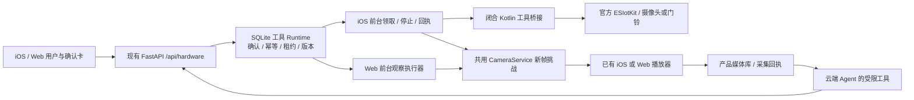

# 工具链接入：iOS 执行器、Web 事件与共用 Agent

本轮在 `dongrunze` 先合并 `main@cc16c98`（merge `7f2c1e6`），保留 iOS 诊断 URLSession 隔离及等待修复。使用团队 `EvidenceGuard_AgentTools_Source_v0.2.0.zip`，摘要为 `818175fe2f43b8ea8f67751d45e51ca3ea1dd2b69a581629b747645f1bd7b434`。此文说明本轮产品实现，不把旧构建或模拟测试当作新硬件验收。

## 1. 实际接入方式

工具 Runtime 运行在现有 FastAPI 内，产品路径为 `/api/hardware/*`；没有启动包内独立 HTTP 服务，没有要求 App 保存另一套 human/agent 共享 Token。继续使用团队 Bearer 和 `X-EG-Installation-ID`；服务器为前台执行器发放绑定安装标识、设备及平台的随机令牌，通过 `X-EG-Executor-Token` 回传。官方账号 Token 继续只在官方 SDK 宿主中使用。



设备继续使用 `sdk-<SHA256(SN) 前20位>`；事件登记与直播登记合并为同一设备。新增工具数据库为原库同目录的 `<库名>-hardware.sqlite3`，现有表不做破坏性迁移。工具观察重用已经打开的媒体会话，不另建播放器或第二条视频帧订阅。

普通团队部署仍是单团队服务：持有团队令牌的用户能访问团队设备并确认操作；安装 ID 隔离执行宿主，不是独立成员身份或完整多租户 ACL。成员级权限属于后续服务能力。

## 2. 本轮实现范围

| 范围 | iOS | Web | 后端 / Agent |
|---|---|---|---|
| 官方原版切换 | 保留原版 Compose 工作区，先断执行租约并等待有界 SDK 调用结束，再释放直播、切换 | 保留原版 Demo，工具轮询和产品直播释放后才切换 | 已领取未完成记 unknown，未下发取消，不报告设备成功停止 |
| 设备事件 | 保留 main 的设备发现、前台事件同步和缩略图核验 | 新增事件设备概览、按设备筛选、毫秒时间、缺图/核验/录像标记 | 复用 `/api/sdk/events` 与 bootstrap.cameraEvents；不把 SDK 事件标签当作视觉事实 |
| 本次新画面 | 前台执行器调用产品 challenge；采集前再次读取 SDK 隐私状态 | 观察执行器调用同一 challenge；无第二播放器 | 持久化到现有 `/api/media/*`；生成短期工具观察引用；可交给聊天视觉或已有视觉复核模型 |
| 设备状态/设置目录 | 已有闭合 SDK 分支，需人工诊断及真机核验 | 可请求在线 iOS 宿主执行 | 未经对应版本验证，不加入 Agent 可执行工具列表 |
| T8171 PTZ/预置位 | 单步、目录、跳转及独立 stop 分支 | 向 iOS 委派，不伪装成 Web SDK 已直接支持 | 对象/视角引用、确认、幂等、能力版本与租约检查 |
| 夜视、4 个设置字段 | 夜视选项读取/设置；statusLED、microphoneEnabled、audioRecordEnabled；T8171 ptzSpeed | 委派 iOS | 每次控制确认；麦克风设置不等于开启对讲 |
| T8214 灯光/双摄/回复目录 | 已有有限分支；双摄要求新视角；回复播放维持未就绪 | 委派 iOS | 准备完成的回复 ID 没有可信来源，所以不会开放播放 |
| 对讲、录制、SD 下载、订阅、其他动作 | 未接入执行器 | 未接入执行器 | 保留包内 schema；不能登记成已实现，不会因目录有名字就开放 |

包内共有 29 个工具定义。原生桥接最多 14 个 SDK 分支，按型号减少，另接一条产品观察路线；本轮并非完成 29 项硬件功能。Web 原生执行器只登记观察。Android 仍是 SDK 参考平台，本轮没有交付 Android App。

## 3. 使用步骤

1. 启动现有 Cloud，配置团队访问、聊天/视觉模型；不需要另起工具服务。新数据库默认随现有数据目录持久化，部署备份必须同时覆盖产品库与工具库。
2. Mac 恢复官方资料并执行 `SDK/prepare.py`，重新编译 `EvidenceGuardSDK`。脚本会复制 `SDK/Bridge/Tools/*.kt`，对实际恢复的 iOS `libs` 生成 SHA-256，并写入 `EGSDKArtifactHash`。旧 SampleCore 或缺指纹的构建不会启动执行器。
3. iOS 连接官方账号并发现设备，前台会将相同设备身份登记到现有后端，再登记执行器。进入“摄像头 Skill → 硬件工具与执行回执”。普通 Simulator 不包含官方 arm64 SDK，不能登记成真实执行器。
4. 先启用“人工诊断”，从只读状态/设置目录开始检查。工具参数与真实引用可展开查看/复制；控制请求必须再次点“确认这次操作”。核对设备、固件、SDK 构件和实际现象后，填写真机记录，逐工具登记 passed 或 failed。
5. 观察工具需要执行端前台已打开该设备直播。请求新帧只接受 challenge 之后的解码活动，图像进入原有证据库，设备拍摄时间未知时保留未知。模型未完成图像理解时不能仅凭截图成功描述场景。
6. Web 进入同一个团队后，可查看来自 iOS 的事件及操作回执。在 Web 设备页可发起已接入原生工具；iOS 必须保持前台在线。请求端与执行端分别显示；旧客户端未报告来源时标记 unknown。
7. 同一设备不自动抢占。需先停止旧直播，取消排队操作；在途或 unknown 必须停止/核对，再显式“释放执行端”。旧引用与验证记录作废。iOS 收到失效授权后在当前前台会话内停止自动重登，重新进入前台/重连设备后才再尝试。

当前执行器还未接通固件版本回读，上传 `unknown`；服务端在每次重新登记时生成新能力版本，使旧真机验证和引用失效。因此当前版重连后需要重新验证，不能仅凭旧的 passed 记录自动开放 Agent。真实固件版本需写入核验记录，后续接入可信回读后才可按精确固件版本复用验证。

### Web 隐私与观察的具体边界

Web 没有已接入的 SDK 隐私回读，不能因为看得到视频就声明隐私关闭。登记始终使用 `privacy=unknown`。需要测试工具观察时，在官方界面核对后，填写记录并点击“已核对隐私关闭，仅授权诊断取样”；仅对当前安装、当前媒体会话开放 5 分钟人工诊断，不给 Agent 自动开放此 Web 路线。切换会话后失效。原有 Agent `request_camera_snapshot` 的 Web 前台取流能力继续保留。

仅在 iOS 端有该型号、构件与路线的实际 passed 记录，工具才进入当前 Agent allowlist。历史模式和主动提醒的只读工具集合不扩大。用户说“通过了”或模型写 diagnostic 参数不能绕过服务端角色。

## 4. 请求与回执约束

- 工具 JSON Schema 封闭；不接收任意 SDK 方法名、设备路径或厂商 URL。native referenceHandles 仅发送给指定执行器，普通页面、Agent 回执不含 vendorHandle/leaseToken。
- 幂等键由宿主生成；同一 Agent 运行、工具、参数生成稳定键。HTTP 回执丢失只重传结果，不重调 SDK。Web/iOS 请求来自哪个端，不改变最终执行宿主。
- Web 回执/领取遇到网络或服务暂时错误会限次重试；授权失效立即退出。读取 SDK 构件也有超时和切换取消，避免卡住官方工作区切换。连续失败后保留未知状态，不重新执行设备动作。
- 控制状态为 awaitingApproval → queued → executing → completed/failed/unknown；completed 表示收到执行回执，physicalResult 仍为 unverified。确认绑定 requestHash。
- stop 领取不受正在取帧阻挡，并可与有界 SDK 调用并行等待。执行回执先到时不能吞掉 stop；stop 先到时旧执行回执不能把取消改成成功。没有 stop SDK 分支的动作不得声称已停。
- 捕获和已下发控制共用设备排他约束。活跃 Skill 持有设备时先暂停，才允许控制；运动/双摄回执与未知结果使旧直播视角及观察引用失效，重新取样后再判断。当前仍未开放通用真机持续 Skill 发布，不能由本次工具通过推导持续守护已完成。
- unknown 需要明确人工核对才能释放租约；不会因此把历史结果改成成功。进程重启取消未发出的命令，已发出保留 unknown。
- 短期工具引用与持久证据分开；工具镜像仅 JPEG/PNG ≤2MiB，必要时压缩验证后的产品图，原始产品证据保留。读取通过已有团队鉴权媒体接口。本轮未实现 R2 存储适配。

## 5. 产品新增 API

所有路径沿用原服务鉴权；除 executor 登记外，执行器专用路径还要求绑定令牌。模型只看到 allowlist 内的工具 schema，不能调用人工确认/验证/释放 API。

| 方法 | 路径 | 用途 |
|---|---|---|
| GET | `/api/hardware/snapshot` | 设备路线、版本、验证记录、最近 200 操作；过滤宿主秘密 |
| POST | `/api/hardware/call` | `{name, arguments, idempotencyKey, platform, taskId?, diagnostic?}` |
| POST | `/api/hardware/confirmations` | `{operationId, requestHash, decision: approve/reject}` |
| POST | `/api/hardware/validations` | 精确设备、工具、capabilityRevision 与人工证据 |
| POST | `/api/hardware/reconcile` | unknown 的匹配 requestHash、明确决定和核对记录 |
| POST | `/api/hardware/devices/{id}/release` | 已停止后的显式宿主交接 |
| POST | `/api/hardware/devices/{id}/privacy-check` | 当前 Web 会话的人工诊断隐私核对 |
| POST | `/api/hardware/executors` | 登记实际路线、构件、型号、字段范围及官方身份就绪状态 |
| POST | `/api/hardware/executors/{id}/claim` | 领取命令/停止并刷新心跳 |
| POST | `/api/hardware/executors/{id}/observe` | 通过现有媒体 challenge 获取观察；相同租约不重复采集 |
| POST | `/api/hardware/executors/{id}/result` | 带 operationId、leaseToken、command、status 的结果重传 |
| POST | `/api/hardware/executors/{id}/disconnect` | 停止宿主，作废 token，取消排队/保留在途未知 |

原 `/api/agent/runs` 新增可选 `clientPlatform: ios/web`，旧请求不必修改。run 增加可选 hardwareOperations，确认/执行回执更新同一条 run。其他旧路径和响应结构保持兼容；新客户端增加可选字段解码。没有将 `/v2/*` 当作产品接口暴露。

## 6. 源码与测试入口

| 文件 | 职责 |
|---|---|
| `Cloud/server/evidenceguard/hardware_tools/{gateway,routes}.py` | 产品身份/角色、设备与任务映射、短期 Runtime 与媒体/Agent 关联 |
| `hardware_tools/vendor/camera_tools/`、`contracts/camera-tools/` | 团队 v0.2.0 Runtime 与原协议；修改点见 UPSTREAM.md |
| `harness/{tools,runtime}.py` | raw JSON Schema 适配、逐运行 allowlist、确认卡、视觉模型衔接 |
| `camera/{service,live}.py` | 采集排他、旧视角作废 |
| `EvidenceGuard/HardwareTools.swift` | iOS DTO、前台宿主、并发 stop、结果重传、人工检查页面 |
| `OfficialSDKConnection.swift`、`SDK/Bridge/Tools/` | Swift facade 与闭合 KMP SDK 调用 |
| `Web/src/{hardware-tools.ts,HardwareTools.tsx}` | Web 观察宿主、跨端操作与确认卡 |
| `Web/src/{CameraEvents.tsx,device-overview.mjs}` | 事件时间线及事件/直播设备合并 |
| `Cloud/server/tests/test_hardware_tools.py` | 身份/确认/幂等/停止竞态/新帧证据/Agent/历史兼容 |
| `Web/tests/browser/hardware.spec.ts` | 桌面/手机事件页、跨端确认、并发停止与旧凭据清理 |
| `Tests/CompatibilityAPI/APIClientTests.swift` | 原生 URLSession 新 envelope、数据类型及执行令牌兼容 |

本地执行：

```powershell
.venv/Scripts/python.exe -m pytest -q -p no:cacheprovider
cd Web
npm test
npm run build
npx playwright test
```

共享 Kotlin 类型检查（需要 Android Studio/Kotlin/JDK 与 Android platform 36）：

```powershell
.venv/Scripts/python.exe SDK/typecheck_tools.py --sdk-root "../安防赛题材料/demo工程/AppSDKDemo"
```

该检查只针对交付 Android AAR 的共享 API 类型，**不验证 iOS SDK 导出或链接**。iOS 普通模拟器编译与 XCTest 用仓库 CI / `scripts/test_ios_compatibility.sh`；[原 Mac 验证交接](IOS-MAC-VERIFICATION.md) 固定的是前一轮提交，本轮需改为 PR 的最新提交。官方 SDK 需在 Mac 重新 prepare，按 [实时接入指南](LIVE-DEVICE-INTEGRATION.md) 使用 workspace 的 EvidenceGuardSDK 真机方案重新编译。

2026-10-15 本地验证结果：

| 检查 | 结果与边界 |
|---|---|
| Cloud 全量 pytest | 230 passed；包括本轮 14 个工具集成测试。存在 Starlette/AnyIO 的依赖弃用警告 |
| Web 单元 / TypeScript / 生产构建 | 11 passed；类型检查及 Vite 构建通过 |
| Chromium / Firefox / WebKit / 手机 WebKit | 完整回归 124 passed、4 skipped；跳过项为 Windows WebKit 的 MP4 解码用例，不标为通过 |
| 最后一次 Web 回执重传修改 | 对上述四浏览器重跑工具专项，8 passed；确认只重传回执、只取样一次、停止并发及旧账号凭据清理 |
| 共享 Kotlin 工具桥接 | 对官方 ESIotKit 2.2.7 Android AAR 类型检查通过；AAR SHA-256 `27916001d9f973361910e2a59da3a870f540f3038816dfc6141b3d33c633f87a` |
| iOS / 物理设备 | Windows 无 Xcode，未完成本轮 Swift 编译、XCTest、官方 arm64 链接或摄像头实测；CI 状态另见 PR |

回归期间也修复了助手初始化时输入可能被对话恢复覆盖的问题，并增加可控的恢复等待测试。测试中的执行器和事件是明确标记的替身，不构成真机通过记录。

## 7. 真机剩余验收

T8171/T8214 分别验证发现与官方绑定、隐私回读、首帧/断流/恢复；T8171 四向单步和独立停止、预置位引用；T8214 灯/双摄切换及新会话；夜视选项和四项设置回读；多设备、不同比例视频、锁屏、账号/服务切换、断线后 unknown、两端交接和过期引用。需要记录真实固件、SDK 构件、SDK 结果、物理现象及证据。

回复目录不表示音频已准备；没有接通全双工自由对话、任意边缘模型加载、录像下载或持续后台 Agent。普通 Simulator、AAR 类型检查、浏览器替身测试都不能代替上述验收。
