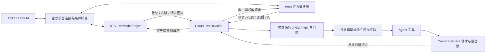

# 实时设备接入：iOS / Web / Cloud

日期：2026-10-14。分支：`dongrunze`。本轮交付的是可联调的源码链路：**登记已绑定设备 → 官方播放器 → 客户端取样 → Cloud 回执 → Agent 观察**。没有将软件测试记成真实硬件测试，也没有发布新 TestFlight 或更新现有云服务。

## 1. 已实现与前置条件

| 环节 | iOS | Web | Cloud |
| --- | --- | --- | --- |
| 已绑定设备接入 | 官方发现列表同步，账号凭证在 Keychain | 官方 Web 握手后输入已绑定 SN；也显示同后端已有设备 | 持久设备清单，SN 哈希作为唯一设备 ID，与事件导入一致 |
| 视频播放 | Kotlin `LiveMediaPlayer`，SwiftUI 承载 SDK UIView | 官方 `Provider` / `DeviceLiveLayout` | 不转发连续视频；协调本项目采集会话 |
| 当前画面 | 有效分辨率和媒体活动后 `cutImage()` | `subscribeMediaChannelFrames`；不支持时尝试实际 video 元素的 `requestVideoFrameCallback` | 请求 ID、截止时间、设备/会话身份、取样序号校验 |
| Agent 输入 | 直播页内提问，同时保持播放器在前台 | 视频旁提问，同时保持播放器在前台 | `request_camera_snapshot` → 新图片或独立视觉核验结果 → 回答 |
| 证据 | 当前观察回执、既有对话/证据界面 | 当次图片、Agent 图片回执、最近观察与证据库 | 图片与来源、运行记录持久化在 SQLite |
| 停止与失败 | 离页/离开前台停止播放器、keepalive 与采集会话 | 停止/切换设备/隐藏标签页结束采集 | 12 秒心跳过期；等待中的请求失败，不回退历史缩略图 |

前置条件：设备已经通过主办方 Demo 或有权限的官方流程完成 Wi-Fi 配网与账号绑定，已取得对应环境的凭证。iOS 可切换到已嵌入的官方工作区执行其配网/绑定流程；本项目自己的扫码保存序列号与设备导入仍只是登记，真实绑定结果须实机验收。交付的官方 Web Demo 没有完整配网导航；Web 不需要为了看设备画面调用电脑摄像头扫码，设备 SN 可以手输或来自 iOS 同步。见 [官方工作区](OFFICIAL-SDK-WORKSPACES.md)。

仅接受比赛的 T8171 / T8214。每个物理 SN 对应一个设备记录，当前媒体通道为 `main`。T8214 返回的主画面可能包含双摄合成，不拆成两个未经验证的独立摄像头。

## 2. 实际运行架构



1. 客户端成功建立官方会话后，向我们的 API 登记设备。设备 ID 为 `sdk-` + SN 的 SHA-256 前 20 位，重复导入不新增设备。
2. 客户端先申请 Cloud 采集会话，再启动播放器。每个设备只允许一个活跃采集会话，避免 iOS/Web 同时竞争同一设备的采样控制。
3. 视频仍经官方链路进入客户端。客户端只在内存保留当前样本和媒体活动；没有定时把整段视频上传 Cloud。
4. 用户点击取图或 Agent 调用 `request_camera_snapshot`，CameraService 分配独立 request ID，并保留现有设备锁、任务 epoch 和超时校验。
5. 客户端轮询待办请求，等待后续媒体活动/新帧，回传 JPEG/PNG。服务端检查 session token、installation ID、设备、request ID、序号、截止时间及图片本身。
6. 图片写入受鉴权保护的媒体存储，回执进入持久事件/Agent run。只有这个请求的图片才能进入本轮模型输入。

**多设备与多客户端：** 后端登记数量不限定为两台；同型号不同 SN 各有独立记录和会话。当前 iOS 页面和单个 Web 标签页一次显示/采集一台，多台可由多个客户端分别采集。同一 Cloud 团队下，Web 可以向正由 iOS 采集的设备请求截图，反之亦然；第二个客户端不因此获得已经播放的原生视频轨道。要在第二端播放视频，需先停旧采集会话，或等其过期。

该协调范围仅覆盖本项目接入端，不协调其他厂商 App 或其他后端实例。现阶段保持**单进程**运行，不增加 uvicorn workers，也不宣称已有分布式设备锁。

## 3. 画面新鲜度的准确含义

本轮没有可核验的设备传感器绝对时间。回执字段如下：

| 字段 | 含义 |
| --- | --- |
| `capturedAt` | 本链路为 `null`，不以客户端时钟代替设备拍摄时间 |
| `sampledAt` | 客户端从 SDK 直播画面读取图片的 Unix 秒数 |
| `receivedAt` | 服务端收到回执的 Unix 秒数 |
| `timestampMeaning` | `client_live_sample` |
| `sourceType` | `official_live_ios` 或 `official_live_web` |
| `frameId` / `deviceRequestId` | 本次图片及服务端请求标识 |
| `viewRevision` | 本次采集 session ID；不是云台位姿版本 |

Web 要求媒体 timestamp 前进，并在客户端收到请求后再等下一次帧回调。iOS SDK 目前只桥接出 UIImage；我们在请求后等待新的媒体活动回调，再调用 cutImage，并要求有效分辨率与最近 4 秒内的媒体活动。**iOS 的码率/VideoInfo 回调不是传感器 PTS，不能据此保证传感器画面延迟。** 静态场景不通过像素差异判断新旧，以免把正常不动的现场全部拒绝。

服务端不接纳无待办请求的图片，不把缓存封面填入实时请求。Web 旧/重复 timestamp、过期请求、错误设备回执会失败。上传最大 5 MB，只接受尺寸相符的 JPEG/PNG，最大 1600 万像素。

软件测试证明上述协议约束，不证明不可信客户端无法伪造图片。采集端目前属于同一受信任团队；正式产品仍需服务端厂商所有权核验、成员权限和更完整的来源认证。

## 4. 本地启动

### Windows

在仓库根目录，用 Python 3.12 建立环境：

```powershell
python -m venv .venv
.\.venv\Scripts\python.exe -m pip install -r Cloud/server/requirements.txt
Copy-Item .env.example .env
# 在 .env 填模型配置；不要把真实密钥提交 Git。
$env:EG_ENV_FILE = (Resolve-Path .env).Path
.\.venv\Scripts\python.exe -m uvicorn evidenceguard.app:app --app-dir Cloud/server --host 127.0.0.1 --port 8790
```

再开一个终端：

```powershell
python scripts/import_web_sdk.py "C:\你的目录\安防赛题材料\demo工程\WebSDKDemo\public\sdk"
Set-Location Web
npm ci
npm run dev
```

浏览器访问 `http://127.0.0.1:5173`。官方 Web SDK 未恢复时，仍可联调助手、任务草案、录像上传、记忆与设置；官方设备播放会提示缺少 SDK。

### macOS / Linux

```bash
python3 -m venv .venv
.venv/bin/pip install -r Cloud/server/requirements.txt
cp .env.example .env
EG_ENV_FILE="$PWD/.env" .venv/bin/uvicorn evidenceguard.app:app --app-dir Cloud/server --host 127.0.0.1 --port 8790
# 另一终端恢复 Web SDK，然后在 Web/ 执行 npm ci && npm run dev。
```

视频文件分析与原有相关测试仍需 FFmpeg / ffprobe；实时单图通路不依赖本项目进行视频转码。

### 同源托管与手机访问

在 `Web/` 执行 `npm run build`，启动 Cloud 前设置 `EG_WEB_ROOT` 为仓库 `Web/dist` 的绝对路径。Cloud 将前端静态文件与 API 放在一个来源，反向代理只需指向该 Cloud 实例。

`127.0.0.1` 只指当前电脑。手机不能用这个地址访问电脑；团队测试需给服务配置可访问的 HTTPS 域名及 `EG_REQUIRE_AUTH=1`、32 字符以上随机团队令牌。iOS 的服务配置也指向同一后端。浏览器 Web Crypto、媒体相关 API 需要安全上下文，普通局域网 HTTP 不能视为等价环境。localhost 例外只适用于浏览器所在电脑。

生产部署、证书和 App 发布沿用既有文档，本轮没有替换正在使用的云端环境。

## 5. iOS 与 Mac 交接

1. Mac 拉取 `dongrunze`，从有权限的渠道取得主办方 SDK 包。
2. 执行 `python3 scripts/import_sdk.py /绝对路径/工具资料包.zip`。文件恢复到被 Git 忽略的 `SDK/Vendor/`。
3. 安装已有构建说明要求的 JDK 17、Ruby / Bundler / CocoaPods，执行 `python3 SDK/prepare.py --check` 和 `python3 SDK/prepare.py`。后一步复制最新版 Kotlin bridge 并重新配置工程；旧的 SampleCore 二进制没有新增导出接口。
4. 打开 `EvidenceGuard.xcworkspace`，选择 **EvidenceGuardSDK + iPhone 真机**。普通 `EvidenceGuard` target 可编译 UI / API，但不能调用官方媒体库。
5. 连接本次部署的 Cloud → 我的 → 官方 SDK → 输入 User ID / Token / PR 或 QA → 查询设备 → 同步设备 → 进入“实时画面与 Agent”。
6. 用实时页内的提问框测试，不要切到另一个标签后假设原生播放器还在后台运行。
7. 完成真机验收后按既有 `Docs/TESTFLIGHT.md` 执行签名归档、上传和测试说明更新。本轮没有上传新构建。

相关源码：`SDK/Bridge/EvidenceGuardSDKBridge.kt`、`EvidenceGuard/OfficialSDKConnection.swift`、`EvidenceGuard/LiveCameraView.swift`、`EvidenceGuard/APIClient.swift`。Windows 无法证明这些新增 SDK 调用已通过 arm64 链接；普通 Simulator CI 也不能替代它。

## 6. Web 官方接入

当前固定官方 **PR / US** 路线。页面需要主办方发放的 App Name、Client ID、Client Secret、Preset Key、Eufy User ID、Account UUID；这些不等同于 Cloud 团队令牌。不同参数不能互相代填。iOS 与 Web 登记同一设备时，应使用相同官方用户标识及环境；不匹配时后端拒绝自动合并。

握手：查询域名 → P-256 ECDH 交换 → `request_token` → 创建官方 `OpenAPIIntegration` → 使用设备 SN 开流。本项目握手采用浏览器 Web Crypto，仍按官方协议保留 32 字节共享密钥的前导零并取前 16 字节。

官方 OpenAPI 通过 `/api/sdk/openapi/...` 同源代理避免 CORS 问题，目标固定 `https://openapi-us.eufylife.com`，仅允许 GET/POST `v1/` 路径，不接受任意目标 URL，不跟随重定向。官方 Authorization 头保留给厂商；本项目团队鉴权另用 `X-EG-Access-Token`。代理必然会经过受信任的 Cloud，不应描述成密钥从未离开浏览器。

鉴权参数仅保留页面内存，不放 localStorage，不打进构建产物；刷新需重新连接官方账号。只有本项目 installation UUID 存入 localStorage。该入口用于团队 SDK 联调，正式用户版需要另做登录和服务端短期授权。官方交付的是调试 SDK，包中存在请求/密钥调试输出；未经脱敏不要分享原始浏览器日志。本项目的 npm 依赖检查不涵盖该外部二进制包。

浏览器首选当前 Chrome / Edge。没有 MediaStreamTrackProcessor 时会尝试 video 帧回调取样；仍需 Safari/iPhone 实机核对官方解码与画面访问能力，不能声称所有手机浏览器已通过。

## 7. 共用 API

所有 API 沿用团队鉴权；个人会话/采集端请求附 `X-EG-Installation-ID`（UUID）。媒体 session 的操作另附 `X-EG-Media-Session`（创建会话返回的随机 token）。

| 方法与路径 | 内容 |
| --- | --- |
| `GET /api/devices` | 已登记设备 + 当前媒体能力；没有采集会话不标为画面在线 |
| `POST /api/devices/import` | `accountId, environment, platform, devices[{sn,model,name}]`；幂等登记，不是官方绑定接口 |
| `POST /api/media-sessions` | `deviceId, platform`；返回 `id, deviceId, token, heartbeatTTL` |
| `POST /api/media-sessions/{id}/heartbeat` | `state, sequence, frameAgeMs`；更新媒体可用性 |
| `GET /api/media-sessions/{id}/commands` | 待取样的 `requestId, deviceId, afterSequence, deadline, channelId` |
| `POST /api/media-sessions/{id}/frames` | `requestId, sequence, channelId, imageBase64, width, height, sampledAt` |
| `POST /api/media-sessions/{id}/stop` | 结束当前采集会话并使待办请求失败 |
| `POST /api/devices/{deviceId}/capture` | 用户手动请求新图，与 Agent 共用 CameraService |
| `GET /api/captures` | 最近最多 100 条持久摄像头成功回执中，来自官方直播的取样记录 |
| `GET /api/media/{id}` | 受鉴权保护的图片内容 |
| `POST /api/agent/conversations/main` | 无请求体；按安装标识幂等恢复主助手会话，保留原 iOS 绑定 |
| `POST /api/agent/conversations` | 传 UUID `requestId`，创建独立话题 |
| `POST /api/agent/runs` | `message, conversationId, requestId`；`cameraId` 可选，查看现场时选择设备；`executionMode=history` 限定已保存资料 |

设备记录持久化，session token 只以内存哈希保存。服务重启后全部设备需要重新建立采集会话；旧 token 不可恢复使用。服务端会检查导入账号指纹冲突，但 `ownershipVerified=false`：官方设备归属仍由当前受信任 SDK 客户端报告，并非本后端独立核验。

## 8. 模型配置

两条路径择一：

- 对话模型可看图：`EG_MODEL_VISION=1`，配置 `EG_MODEL_BASE_URL / EG_MODEL_ID / EG_MODEL_API_KEY`；工具成功后将对应图片作为 image_url 数据发给模型。
- 对话模型只支持文本：`EG_MODEL_VISION=0`，另配 `EG_VIDEO_BASE_URL / EG_VIDEO_MODEL_ID / EG_VIDEO_API_KEY` 为可看图的 OpenAI 兼容模型。VisualReview 先描述画面，结果与局限进入对话工具回执。该路径共用现有视觉额度，额度耗尽或模型失败时明确无核验结果。

没有配置模型仍可试直播和手动取图，但 Agent 不会有有效视觉回答。单次回答不创建或启用持续 Skill；`physicalDevicesValidated` 仍为 false，守护发布检查没有绕过。

## 9. 验收记录与团队分工

软件检查覆盖：设备身份持久化、同型号多设备、账号冲突、会话归属、无权限访问、旧帧/其他设备/重复回执拒绝、停止与过期、真实图片解码、HTTP 取帧全流程，以及 Agent 直接看图/独立视觉核验两条路径。测试使用明确的合成图片和脚本模型，**没有调用真实摄像头或把脚本模型当真实视觉理解验证**。

本地后端 153 项测试通过；Web 的 2 项关键协议测试、TypeScript 与生产构建通过。浏览器实际检查了登录保护、设备空状态、接入表单、Escape 关闭与焦点恢复，并在约 390 CSS 像素宽度确认主卡片与弹层无横向溢出。手机尺寸截图通道超时，因此该部分是浏览器 DOM/布局检查，不是 iPhone/Safari 真机视觉验收。桌面实际页面截图保存于本地被 Git 忽略的 `Docs/LIVE-WEB-DESKTOP.local.png`。GitHub CI 执行 Cloud / Web / 普通 Simulator 检查。

| 实机检查 | 操作与通过标准 | 执行端 |
| --- | --- | --- |
| 官方编译 | 重新生成 bridge 并完成 iPhone arm64 Debug / Archive，无新增未解析符号 | Mac |
| 注册一致 | 同 SN 在 iOS/Web 使用同官方账号登记，只出现一个设备 ID | iOS + Web |
| 双型号直播 | T8171、T8214 分别开流；有真实首帧，现场移动物体与画面一致 | 两端分别测试 |
| 单图对应 | 将现场物体换成另一颜色/位置后请求，返回图片应与新现场一致 | 两端 + Cloud |
| 模型观察 | 配置真实视觉模型，提问后工具图片与模型描述一致；遮挡时承认不确定 | 两端 + Cloud |
| 跨端请求 | 一端保持直播，另一端向同 deviceId 取图；图片来源与采集端一致 | iOS + Web |
| 会话占用 | 第一端开流后第二端开流被拒绝；第一端停止或过期后可重新接管 | iOS + Web |
| 中断恢复 | 停网/关标签/锁屏后不再成功返回旧图；恢复后由用户重新开流 | 两端 |
| 重启与历史 | 重启服务：设备记录和已存观察仍在，会话为未连接；需重新开流 | Cloud |
| 断网录像 | 本轮不判断设备 SD 卡录像与同步；另按官方测试方案验证 | 硬件负责人 |

自有业务接口尚未实现：首次配网与绑定、更换 Wi-Fi、BLE 产品流程、家庭角色/成员分享、跨设备完整聊天同步、原生持续后台网关、设备控制/PTZ/双向对讲的业务封装、SD 卡/官方云录像拉取、R2 媒体迁移。首次绑定与完整设置可在 iOS 官方工作区核验。Web 已补齐 Skill 编辑、录像上传、试跑、任务、记忆与设置，见 [Web 0.2](WEB-PRODUCT-PARITY.md)；这些界面不会解除真机发布限制。

## 10. 常见失败

- **登记成功但不能看：** 登记只保存来源；核对官方账号区域、Token、设备唤醒及真实在线状态。
- **409 已有采集会话：** 在原客户端停止，或等待最多 12 秒心跳过期，再重新开流。
- **后端取图成功，Agent 没有描述：** 检查模型是否支持 image_url，或独立视觉模型配置与额度；图片上传成功不等于理解成功。
- **iOS 找不到新 bridge 方法：** Mac 仍在使用旧 SampleCore。重新执行 SDK/prepare.py 后构建 workspace/SDK target。
- **手机浏览器失败：** 先检查 HTTPS 与官方媒体兼容性；不能用电脑 localhost 地址测试手机。
- **原模拟摄像头消失：** 默认不再自动加载 FixtureLabAdapter；明确进行合成场景回归时设置 `EG_CAMERA_MODE=fixture`。
