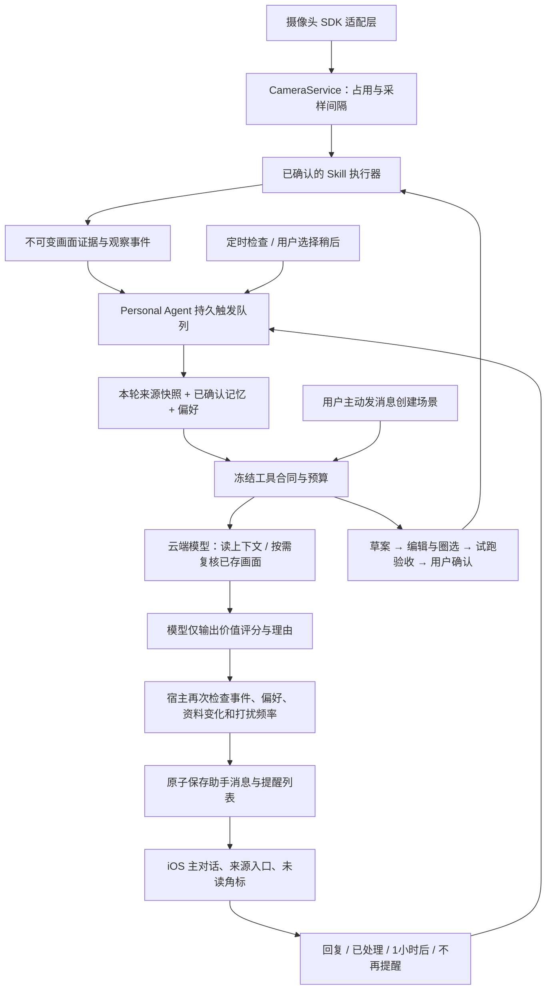

# 手机内部演示与 Personal Agent

> 2026-10-14 当前版本：按用户最新要求使用“助手 / 摄像头 Skill / 任务 / 记忆 / 我的”五栏。助手负责对话，摄像头 Skill 负责设备与能力入口，任务负责进度及定时，记忆独立管理；“我的 → 通知与提醒”统一配置手机推送、主动提醒和免打扰，偏好自动保存。build 8 已完成 Apple 处理和现有内部组分发，组内显示“正在测试”。新加坡生产推送已启用，build 7 的真实手机测试已获得 Apple 接受与手机点开回执；锁屏具体展示、build 8 真机交互和实际摄像头提醒需分别验收。下文为既有功能与历史验证记录。

本轮以原生 iOS 为唯一产品入口。打开即连接云端、直接发送消息，测试者不填写服务器、访问令牌或模型设置。Web 仓库未修改。

## 自动连接与部署

`MobileServiceConfiguration` 从私有构建配置读取演示服务与 demo 访问凭证。演示包忽略旧的 `serviceURL` 偏好，凭证只用于匹配的 HTTPS origin；连接错误分别显示断网、超时或测试版本授权失效。“我的 → 连接状态”只有状态与重新连接按钮。

专用演示服务使用 `evidenceguard-demo` Unix 用户、8792 回环端口、独立 SQLite / 录像目录和 Nginx HTTPS。系统服务开机启动；模型配置由现有服务复制到仅服务进程可读的环境文件。没有复制团队数据或 Apple 专用审核令牌。生成的测试录像有明确合成标识，已经完成索引。

模型 API Key 不在 App 中。内部包带有可提取、可撤销的 demo 访问凭证，它只能访问这套演示服务；这不是面向公众的账号体系。当前摄像头任务和对话仍属于团队演示空间。安装 ID 仅区分偏好，不能当成真实身份或多租户授权；只应使用测试资料。

## 实际架构顺序

1. 手机提供交互、扫描设备标识、确认记忆与规则、查看证据。
2. Personal Context 提供本次运行的已确认记忆、偏好及来源；临时记忆 24 小时后不再进入新运行。
3. Harness 冻结本轮模式、工具列表、摄像头 / Skill 范围及步数限制，检查工具列表漂移，持久化回执。历史对话上下文以完整轮次保留，字符预算 18,000。
4. 当前执行器 `bounded-chat-v1` 调云端模型，工具返回可检验的结果。草案不是新程序，不表示后台已具备对应执行能力。
5. Skill 执行器落实采样、验收和设备独占；CameraService 统一设备请求。历史查询只读已存资料。
6. 摄像头事件、持续无法确认的观察、到期概况和用户选择的后续检查进入 SQLite 持久队列。Personal Agent 经 Harness 读取上下文和已有视觉核验回执，只输出价值评分、理由、来源及消息草稿。宿主独立决定即时候选、汇总、静默和发送时间，核对最新状态和频率后原子交付。

对照的是已安装 MiiMiao v1.0 对照版源码 `c225f46465aaadf460bfc5e736a648192205323e`，其 Codex 版本为 0.153.4。参考了宿主掌握上下文和工具边界的原则；尚未把桌面 Codex App Server 执行器移植到本项目。当前触发条件仍由宿主限定，触发后的视觉理解与价值评分由受约束模型完成，是否提醒和何时提醒由宿主代码决定；没有移植桌面二进制执行、长任务窗口交接或通用目标规划器。

## 手机新增入口

- 首页移除白底文案框，短句位于左侧明亮窗景，使用轻量文字与渐变蓝色细线，避开右侧植物。
- 首页 / 我的设备 → 扫描添加设备 → 确认序列号与位置 → 保存待连接记录。
- 我的 → 助手记忆与提醒：显式保存、移除、24 小时临时记忆，及提醒时间偏好。
- 首页 / 我的 → 助手提醒：来源、时间、已读状态与关联任务。

二维码解析只做有限的设备序列号提取，不打开二维码 URL、不执行其中内容。支持 T8171 / T8214 标识的保守格式；官方完整配网二维码协议尚待确认，未知格式引导手动输入。扫码没有完成官方绑定，也不会把设备标成在线。实际扫码相机权限与两款设备连接仍需 iPhone 和实物验收。

主动提醒默认关闭，由使用者选择开启。云端定时器不依赖手机常驻；消息进入助手对话、提醒列表和未读角标。2026-10-14 已按新授权接入 APNs 授权、登记、持久化投递与通知跳转，生产密钥已安装、发送已启用；当前请更新 build 8，在同页配置手机推送和主动偏好。真实手机的发送及点开回传已跑通，具体显示和目标页仍需手机侧反馈，见 [手机通知接入](APNS.md)。标记提醒已读不改变 Skill 告警或现场结论。

## 构建与复核

私有 xcconfig 仅允许下面三个值，禁止放入模型 Key、团队主令牌或审核令牌。真实文件保持本机私有，不提交 Git。

```xcconfig
EG_INTERNAL_DEMO = YES
EG_SERVICE_BASE_URL = https:/$()/your-demo-host
EG_DEMO_ACCESS_TOKEN = <demo-only-token>
```

```bash
python3 scripts/archive_ios.py --team <TEAM> --bundle-id <BUNDLE> \
  --api-url https://your-demo-host --version 1.0 --build <NEXT_BUILD> \
  --demo-config /private/path/mobile-demo.xcconfig \
  --archive Release/EvidenceGuard-buildN.xcarchive --execute
scripts/check_mobile_contracts.sh
Cloud/.venv/bin/python -m pytest Cloud/server/tests -q
```

`cloud_demo_setup.sh` 在已部署的 Ubuntu 主机上创建隔离服务；源代码应先放到 `/opt/evidenceguard-demo/Cloud/server`。脚本复用已有 ACME 账号，不创建新的 EC2。`prepare_review_fixture.py --environment demo` 在 demo 目录生成并索引自有合成录像。

上一版（build 3）验证：105 项 Cloud 测试通过；Swift origin / 二维码输入边界检查通过；模拟器构建及带真实 SDK 的 arm64 签名归档通过。通过额外全新 Bundle ID 验证了首次安装即自动连接；原生 UI 已验证真实回复、记忆写入后可被模型读出、待连接设备记录和返回操作。归档文件扫描未发现团队主令牌或模型 Key。Apple 分发校验通过，仍有厂商 WebRTC dSYM 缺失警告。1.0（3）已处理完成、补齐本轮出口合规信息并加入现有内部测试组；组内已显示“正在测试”。

后续必须分别验收：TestFlight 新包在用户手机上的网络与权限、官方 SDK 实物绑定 / 采集、其他 Anker 产品适配，以及 Codex 执行器与当前模型协议兼容性。它们不由这次模拟器和模型连通测试代替。


## 2026-10-12：摄像头优先的主动编排

本轮不接飞书、Gmail 或日历。设备画面与守护观察是事实来源；记忆用于理解关注点与提醒方式，不授予设备操作权限。原始图像只有视觉模型实际读取并返回回执时，才能说做过图片复核。聊天模型不接收图像时，`read_observation_image` 调用已配置的 Lite 视觉服务；失败时保留“未复核”结果。



上述两类入口使用同一个 `AgentRuntime`、模型 Provider、ExecutionContract 和 TaskScheduler。主动入口没有创建/启用/切换/删除摄像头的工具，`proactive` lane 并发为 1；它查看的是现有 Skill 产生的证据，不另占实时摄像头。每台摄像头一个实时任务、最小采样间隔 3 s 的原有约束保持不变。

### 触发与决策

| 入口 | 触发依据 | 消息前再检查 |
|---|---|---|
| 事件 | 新 `alert_opened` 的数据库事件 ID | 仍为同一次未解除事件 |
| 自主关注 | active Skill 进入 unknown 持续至少 60 s | 任务仍运行、仍无法确认；同一状态转换只检查一次 |
| 后续检查 | 首次事件未处理至少 5 分钟，或用户选择 1 小时后 | 用户反馈、事件是否解除、是否被新事件替代 |
| 定时概况 | 用户开启后，按本地时区每日到点 | 当天去重、开关仍有效、读取最新任务事实 |

模型先用只读工具查来源；已有视觉回执直接复用，没有回执才经 VisualReview 核验图片。严格输出 `valueScore`（0–100 整数）、`reason`、`sourceIds`、`title/body` 草稿；拒绝 `action`、渠道或延后时间等字段。代码按 ≥80 即时候选、50–79 待汇总、<50 静默处理。没有来源不能发布；评分不是视觉准确率。

非紧急助手消息默认至少间隔 300 s、每天最多 6 条；这是当前内部演示策略，不替代安防告警通道。免打扰结束后重新判断，不把夜间积压内容直接推给用户。采样持续产生新帧不会使模型永远重试，但任务结论/规则/生命周期变化会使旧判断失效。

### 持久状态与恢复

- `proactive_jobs`：来源去重键、到期时间、状态、尝试次数、run ID、上下文版本与决策原因。失败最多 3 次，每次重新读取资料。模型不能指定延后；规则延后时缓存评分，来源及上下文未变化则不重复调用。
- `assistant_messages`：独立 assistant 消息、触发来源、证据、why、反馈。不会为主动发言伪造一条用户消息。
- `personal_conversations`：安装实例与主对话对应关系；明确引用主动消息时，服务端检查所属安装及对话，再把真实消息放进本轮上下文。
- 发布消息、兼容旧版 inbox、job 标为 sent 处于同一 SQLite 事务，唯一 job ID 防止重启重复发消息。运行中断仅重做只读判断，不重放设备效果。
- 用户“已处理”只影响后续提醒，不关闭 Skill 告警；“已读”不会被当作已处理。后续现场结论仍由新观察产生。

部署限制：当前是一台主机、单个 ASGI worker 与 SQLite。安装 ID 只用于内部演示隔离，不是账号认证；相同团队凭证持有者可以伪装安装 ID，不可用于真实多人隐私数据。多副本必须先加任务租约与正式身份授权；不应直接增加 uvicorn workers。

### 与当前 MiiMiao 的对齐边界

| 层 | 当前移动端实现 | 尚未迁移 |
|---|---|---|
| 上下文 | 宿主组织记忆、来源快照、被引用的主动消息 | 完整可编辑记忆版本链、长窗口交接、token 实测预算 |
| 执行合同 | 冻结允许工具、任务模式、范围与步数 | 桌面完整授权与二进制沙箱 |
| 编排与恢复 | 只读主动任务持久恢复、限流、去重、状态再校验 | 任意长任务规划与恢复 |
| 执行器 | 有界 Python loop + 云端模型；视觉通过工具调用 Lite | Codex App Server 二进制执行器 |
| 回执与交付 | 来源 ID、视觉核验结果、运行事件、主动消息及反馈；APNs 生产服务已就绪 | 真机通知送达与点开验收 |

验收需区分：自动化测试与测试图片可以证明消息闭环和权限边界；不能证明 T8171/T8214 真机持续守护可用。新 UI 需新 iOS 包，已安装的 TestFlight build 3 不会因源码修改自动更新。


## 2026-10-12：事件输入与确定性提醒

- `POST /api/sdk/events`：团队认证下接收 T8171/T8214 事件元数据、实际 JPEG/PNG 内容，最多10条、8MB/批、5MB/图；只接受 `event_thumbnail`，拒绝缓存封面、URL或本机路径冒充图片。
- 设备SN与官方事件ID确定去重身份，支持先元数据后图片；冲突元数据/图片不覆盖旧证据，批次原子写入。事件时间独立于云端接收时间，图片拍摄时间未知时不补造。
- iOS设备联调页可同步所选日事件，或在页面前台每30 s查询最近120 s。最多返回50条，每轮补最多10张图片；达到上限明确提示不完整。锁屏/离页停止，不能宣称持续后台采集。
- SDK Bridge直接映射结构化检测类型，无模型解析。已知类型进入10 s事件聚合，最多选3张按时间排序的图；一次多图调用，不是每条并发调用。未知类型保存但不自动核验。日历/飞书/邮件连接器本轮不实现。
- `VisualReview`：单台UTC自然日100次自动视觉请求、单事件最多2次；失败也计费计数。缓存按模型、图片、时间及事件标识隔离。已核验结果跨主动跟进复用。回放自动采样也经过日预算，仍保留每次回放20次上限。预算用尽保留unknown和证据，不假装正常。
- 官方事件只读核验完成后更新证据。5分钟内的新事件可进入主动评估；1小时后不再作为即时新提醒。导入历史记录不触发现场告警；没有创建、启用或抢占Skill。
- 同任务事件或同摄像头同类型事件10分钟内合并到原消息卡片，保存来源、更新时间与合并次数。已处理/不再提醒的卡片不被复活。非紧急消息默认22–08免打扰、每天6条新卡片、至少5分钟间隔；事件证据不受提醒上限删除。
- 50–79分事项保留在待汇总队列，仅在用户开启的每日概况中引用；过期、已解除事项不再汇总。APNs 接入后的发送仍遵循这些策略；生产配置进度见 APNS.md。

软件验收与实机验收分开：协议可用与模型可调用，不代表 SDK 登录、真实图片、锁屏持续入口、包裹识别误报/漏报已通过。两台设备和官方凭证到位后必须补做正反例测试。

2026-10-12 阶段验证：133项Cloud测试通过，真实模型测试资料得到15分，属于静默档；当时尚未部署。最新状态见下节，手机上的build 3不会自动获得新原生入口。

## 2026-10-13：构建 4 的演示闭环

手机独立 demo 服务已更新，会话目录、SDK 事件导入、视觉核验缓存与额度、主动消息策略和合成场景走真实 HTTPS API。部署前备份源代码、SQLite 和环境配置；失败会恢复旧源代码和配置。团队服务和 Apple 审核服务没有随此轮替换。

- 「我的 → 测试主动守护场景」提供包裹离区、区域遮挡、没有变化三个场景。自有合成 JPEG 模拟 0/3/6 s，每次只调用一次视觉模型批量看三张，再进入正常评分和提醒策略。没有硬编码模型答案或强制推送。
- 每张图显示合成水印、模拟秒数和生成时间；生成时间不是真实摄像头采集时间。可打开证据并在只读历史模式追问。测试不导入官方事件、不绑定设备、不启用 Skill，三张样本也不等于完成真实 Skill 的验收。
- 普通主动事项分数 ≥80 才进入即时候选，50–79 等待用户开启的每日概况，<50 静默。单独订阅的每日概况允许 ≥50 的有用汇总；空概况仍可静默。汇总带原始来源与已完成视觉回执，复用核验结果；免打扰、每日上限、最短间隔等规则仍执行。
- 场景页面显示视觉阶段、策略结果、价值分、原因，以及尚未发送的助手草稿，方便查看为什么发送或没发送。关闭主动提醒时只保存证据。每手机 UTC 日最多 6 次场景，全服务同时核验 1 个测试；非 demo 服务默认关闭测试入口。
- 未发送文本、实时/历史模式、未确认的发送请求和新话题 requestId 在手机按服务 origin 持久化。重开恢复草稿；相同文本与范围重试复用请求 ID。收到服务器回执或重新查询确认已接收后才清理，避免网络断开时重复发消息。

最新回归：146 项 Cloud 测试通过；Swift 服务 origin、二维码、聊天持久化契约通过；新版 Simulator 编译通过。公网验证匿名 bootstrap 401、自动鉴权 200、会话 API、场景提交幂等、实际视觉与价值评分调用、图片证据访问。模型对同一包裹合成变化两次分别评分 60/65，正确保留为汇总候选，并明确不能证明拿走过程或真实家庭风险。

另外两种场景也通过公网调用实际模型：区域遮挡得到 62 分，进入待汇总，明确无法确认纸箱去向或连续动作；没有变化得到 15 分，保留证据并静默，没有产生即时提醒。上述评分是这几次调用的结果，不是写死的场景答案，也不是模型准确率或真实设备验收。

模拟器验证使用独立安装实例，临时开启当前小时的每日概况及全天允许提醒；没有修改团队成员手机偏好。真机 SDK、实际绑定、持续取图、手机蜂窝网络与后台接收仍需后续验收。构建 4 的归档和分发结果见 [TestFlight 记录](TESTFLIGHT.md)。

实际闭环结果：原生 App 的测试得到 65 分、进入待汇总；开启该测试实例的当前小时概况后，模型复用已有视觉回执，给汇总 55 分，由订阅策略发布一条独立助手消息。主对话及提醒列表均显示这条消息，来源可打开三张图片，没有伪造用户消息或抢占摄像头。随后修复旧合成证据缺少 frameId 导致追问工具失败的问题，公网复测 `read_stored_image` 成功，回答明确单张离散图不能证明放下/拿走动作。相同发送请求重试返回同一 run。原生键盘输入的未发送草稿经杀进程重开恢复。
