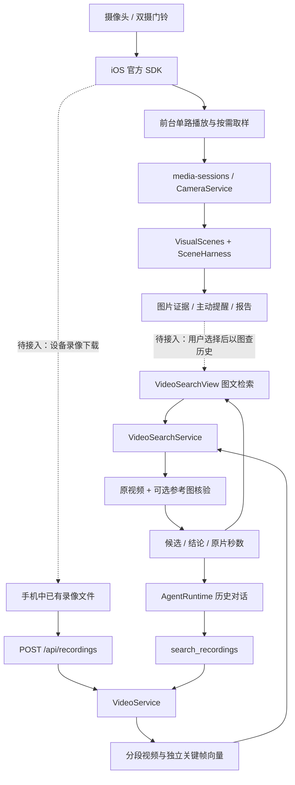

# 向量视频 MVP 与最新 iOS / Agent 架构接入

核对日期：2026-10-17。依据实际 Swift / Python / TypeScript 源码、请求契约和本地测试；本轮没有部署服务器、上传 TestFlight 或重新验收硬件。

**结论：MVP 可以沿用现有 VideoService 接入新版 App，不需要另建 Agent 或替换实时守护。** 当前已经有录像导入、双索引、图文检索、视频核验、原片定位和助手追问。还缺的关键链路是“官方设备录像 → 手机文件 → 本项目录像上传”，以及从新版守护卡直接发起历史检索的便捷入口。

本次同步包含 `main@2a4fd0c`（包含 PR #4 的 `3c82719`、功能提交 `de76def` / `bcea011` 及原生 API 测试身份注入）和 `dongrunze@3f7a591`（包含 `0c62cbf` 的图片归档、执行步骤留存、App 回复显示摘要及后续历史步骤上下文修复）。保留原 `6833c67` 的向量 MVP 以及硬件工具、官方 SDK 工作区。原有本地未提交文档与硬件实验文件另行保全，不混入提交。

**新版架构发生了什么变化**

| 层 | 最新代码的实际职责 | 对向量 MVP 的影响 |
|---|---|---|
| iOS 导航 | 助手 / 摄像头守护 / 设备 / 记忆 / 我的；旧任务移到“全部关注事项与历史任务” | 保留“设备 → 录像库”和助手历史菜单中的检索入口，更新助手的入口提示词 |
| 前台连接 | `CameraRenderHost` 保持原生解码器挂载；`maintainCameras` 维护连接；切换设备释放上一播放器；进入后台停止 | 历史检索不需要再开摄像头；多摄像头历史过滤不等于多路实时播放 |
| 守护创建 | 新 iOS 请求带 `guardFlowVersion=1`，Agent 提供 `create_camera_guard` / `revise_camera_guard` 等工具 | 与 `referenceImageId` 同时保留；历史模式不能获得这些修改工具 |
| 守护编译 | `SceneHarness` 复用现有聊天 provider 或 Codex 执行器、并发 gate；仅输出结构化草稿 | 无需把 Embedding 或视频召回塞进草稿编译器 |
| 持续观察 | `VisualScenes` 管理框选、版本、启用、基线、观察与提醒 | 这是离散画面状态机，不负责生成 MP4 或建立视频向量 |
| 记录与报告 | 事件/画面写入证据；主动消息与早晚报告复用已有投递管线 | 可以回答已保存图片，但不能因此宣称有连续录像 |
| 外部连接器 | 天气/网页、飞书 CLI 等授权只读工具并入已有 Harness | 与视频检索并行，不是视频的索引或存储来源 |
| Dashboard | 新增业务图片及回复台账、有限执行步骤留存、显示文本哈希回执 | 已检查私有参考图和带图追问正文不进入匿名归档；它仍是观察端 |

新版守护首版执行固定视角中对象或类别的进入/离开。观察调度间隔至少 15 秒，确认跨度允许 15–600 秒且至少两个有效样本；长时间断流、遮挡和无法判断不会被解释为目标离开。它要求新鲜的 `official_live_ios` 画面。模型编译排队，不在聊天持有 Codex gate 时同步等待，因此不会与同一模型会话互相等待。

**三条调用链的接入位置**

图中虚线尚未形成产品闭环。摄像头实时取样、设备事件图片、用户检索参考图、录像文件是四种不同的数据；不能用图片台账数量推断已入库录像数量。

**已经打通的接口与状态**

| 操作 | 接口 / 内部调用 | 当前状态与边界 |
|---|---|---|
| 导入录像 | `POST /api/recordings?cameraId=...&recordedAt=...&recordedTimezone=...`，请求体为文件字节 | 已实现。先选已登记摄像头；150 MB 内、0.5–600 秒。上传成功不等于索引完成；未知拍摄时间可留空 |
| 建立 / 重试索引 | `POST /api/recordings/{id}/index`；`VideoService.start_index` → `index_media.build` | 已实现。重启中断需重试；重用已完成向量单元，完整后原子发布 |
| 查看处理状态 | `GET /api/recordings/{id}`；`GET /api/bootstrap` | 已实现。`videoModels.retrievalVersion=2` 只代表服务开启该版本，`embeddingReady` 只代表配置完整，不保证网关可用或已有索引 |
| 上传参考图片 | `POST /api/video-search-images` | 已实现。JPEG / PNG / WebP，5 MB 内、最多 2000 万像素；服务端旋转归一化、去元数据并生成引用 |
| 读取参考图 | `GET /api/video-search-images/{id}` | 已实现。要求当前安装身份及对应私有凭据；不能用他人的引用 |
| 确定性检索 | `POST /api/video-search` | 已实现。`text` / `image_ref` 至少一项；支持 `camera_ids`、`time_range`、`timezone`、`limit`、`verify_limit` |
| 查询异步结果 | `GET /api/video-search/{id}` | 已实现。先返回候选，再更新核验。查询任务属于创建者，不是整个团队共用一个任务列表 |
| 候选缩略图 | `GET /api/video-search/{id}/thumbnails/{clip_id}` | 已实现。检查搜索任务及原录像的可见范围 |
| 播放和定位 | `GET/HEAD /api/recordings/{id}/video`；iOS `RecordingPlayerView` | 已实现 Range/206；`seekSeconds` 是录像内部秒数，不能凭导入时间推算拍摄时刻 |
| 向助手追问 | `POST /api/agent/runs`，`executionMode=history`，可带 `referenceImageId` | 已实现。保留原图、用户原话、摄像头与时间范围；Agent 工具走同一个 VideoSearchService |
| 新版守护 | `/api/visual-scenes` 及 `interpret/frame/selection/activate/pause` | 已实现；独立状态机与数据表，只有用户显式确认才能启用 |
| 删除应用录像 | `DELETE /api/recordings/{id}` | 已实现应用内删除与在用检查；不是删除设备 SD 卡文件 |
| SD 卡录像导出并同步 | 官方原生 SDK 录像适配器 → 手机文件 → 上述上传接口 | 尚未接入产品执行器，不能声称目前已经自动同步 |

确定性检索页默认返回最多 10 个候选并核验前 3 个，核验数量最多 5；Agent 的 `VideoService.search` 默认只取 3 个并等待该轮核验结束，再生成可播放卡片。两者共用模型、索引、过滤和核验逻辑，呈现时序不同。当前 iOS 选择器提供“全部 / 单台摄像头”，接口本身允许摄像头集合。

**向量库和模型如何复用**

视频按照 20 秒窗口、5 秒重叠处理。每个窗口保存一个视频向量和最多三个分别计算的清晰关键帧向量；库侧没有把三帧合成一个向量。模型配置沿用已有 `ArkVideoEmbedding`，示例与上一轮真实网关测试为 `doubao-embedding-vision-251215`，1024 维归一化 float32；每条向量 4096 字节。

查找时先按来源、摄像头、拍摄时间和索引签名筛选 SQL，再分块点积召回。视频与关键帧各取 top 20，按 RRF 合并并处理时间重叠；最后由 `LiteVideoProvider.verify` 检查原始视频和可选原参考图。视频/图片核验示例模型为 `doubao-seed-2-1-lite-260915`。新版实时守护的 `SceneHarness.observe` 是另一个受限视觉判断任务，默认复用视觉配置，也允许完整的 `EG_SCENE_VISION_*` 专用配置；它不是 Embedding 模型。

数据仍在服务的 SQLite 与录像文件目录中：旧 `recordings/video_segments` 保留，v2 新增 `retrieval_recordings/clips/units/embeddings/index_jobs/meta`，另有 `video_query_images/video_search_jobs`。没有引入独立向量数据库或把 R2 当作向量索引。R2 若后续用作媒体对象存储，需要单独实现授权访问和生命周期；本轮未接入。

检索相关分数不是“事件发生概率”。负例仍可能出现在 top-k；`matched`、`not_matched`、`uncertain`、`candidate` 和 `verification_failed` 必须保留区别。上一轮六段合成录像的实验中，动作相反的两个候选曾出现 RRF 同分，最终依赖视频核验区分；不能把这种小样本测试写成真实硬件准确率或已完成身份识别。

**本次具体修复和保留的契约**

- 解决 `app.py`、`harness/runtime.py`、`APIClient.swift` 的三处合并文件冲突，同时传递 `guardFlowVersion` 和 `referenceImageId`。
- `history` 请求即使带新版守护标志，也不能获得 `create_camera_guard`、`revise_camera_guard`、实时截图或任务修改工具；`live` 请求继续使用新版守护卡片。
- 带图追问的 Embedding 与视频核验使用用户原始文字和同一张授权图片，模型自行缩短的工具参数不能替换用户条件；相同请求 ID 改图仍返回冲突。
- 修复纯文字 Agent 检索的归属：已识别客户端也传递 `clientId` 给查询服务，用户可以通过同一搜索状态 API 读取自己的结果；无安装身份的旧内部调用维持原团队兼容方式。
- 对齐新版导航和录像入口提示词，保留 Web 的旧入口说明。原生官方 SDK 工作区、硬件逐次确认、单路前台播放器均保留。
- 合入新的 Dashboard 归档时保留 `PRIVATE_CONTENT` 保护、参考图专表隔离和带图回复正文屏蔽；显示回执只传哈希与版本，不上传回复正文。

隐私范围要准确理解：参考图与搜索任务按经过证明的安装实例隔离；原录像仍属于当前团队服务的共享资料，没有新增按家庭成员的细粒度摄像头 ACL。新守护草稿的安装隔离不自动把整个录像库变为个人私有库；未来需要成员级权限时，要在入库、召回、原片播放和证据查询统一增加授权条件。

**建议接下来按这个顺序接入**

| 阶段 | 可直接复用的部分 | 需要完成的工作 | 验收出口 |
|---|---|---|---|
| 1. 用真实短录像联调 | 当前上传、索引、检索页、Agent 与播放器 | 在 demo 部署经过测试的合并版本，检查实际模型与 FFmpeg；手动导入来自两款设备的录像并正确填写摄像头、拍摄时间/未知状态 | 文字、图片、图文三种查询都能返回可播放原片，离线时仍能查已经入库的录像 |
| 2. 接设备录像来源 | 现有上传 API、文件哈希去重、重试索引 | 增加原生录像列表/下载协调器；从已授权设备取到完整文件后再上传。具体 SDK 方法和 T8171/T8214 支持情况须以官方 API 与真机回执核实 | 两型号分别验证下载、取消、断网恢复、相同录像重传和未知时间；不依赖截图拼接冒充录像 |
| 3. 与守护卡关联 | 现有图片上传及 `VideoSearchView` 查询上下文 | 新增“用这张图查历史录像”操作，用户确认裁剪、摄像头、时间；记录证据/场景关联，不静默创建守护 | 参考图可以追溯到所选画面，原图权限不扩大，搜索不会修改正在运行的场景 |
| 4. 真实检索质量验收 | `video.evaluate_search`、现有结果 JSON 与指标 | 准备 1–2 小时录像、至少 60 条独立查询并划分调参/留出集合，覆盖室内、门口、宠物、包裹、遮挡、负例和门铃双视角 | 报告召回、错误核验、无结果/失败比例、延迟和成本；分别给出两设备结果 |

第 1 阶段不依赖新增设备导出接口，最快能验证“真实素材 → App → Cloud → 检索 → 回放”闭环。第 2 阶段才完成自动化的数据来源。可以把第 3 阶段作为界面增强，不能据此宣称第 2 阶段完成。

对于 T8214，应保留“同一门铃的合成视频”这一事实；`channelId=main` 不是前向物理镜头标识。以后如 SDK 可以独立导出主摄/下视流，才增加经过验证的镜头元数据与过滤，不能把两个画面当成两台设备或假定固定上下布局。T8171 云台转动后，实时框选要重新核对；历史检索可保留转动前后的录像，但不能跨视角推断同一人的身份。

**源码定位**

| 文件 | 关键符号 / 核对点 |
|---|---|
| [RootView.swift](../EvidenceGuard/RootView.swift) | `ProductRootView`，五栏导航、前后台维护、`SDKWorkspaceContainer` 官方原版入口 |
| [OfficialSDKConnection.swift](../EvidenceGuard/OfficialSDKConnection.swift) | `selectCamera` / `maintainCameras`，前台单路切换 |
| [CameraOverviewView.swift](../EvidenceGuard/CameraOverviewView.swift) | `CameraRenderHost`、新版结果优先守护页 |
| [VisualSceneView.swift](../EvidenceGuard/VisualSceneView.swift) | `VisualSceneEditor`，描述、框选、确认和暂停 |
| [EvidenceView.swift](../EvidenceGuard/EvidenceView.swift) | `RecordingLibraryView`，上传、重试索引和检索入口 |
| [VideoSearchView.swift](../EvidenceGuard/VideoSearchView.swift) | `submit` / `poll` / `querySummary`，参考图、结果、能力门控、继续追问 |
| [TeachAIView.swift](../EvidenceGuard/TeachAIView.swift) | `ConversationView`，历史/现场分流、参考图恢复、新守护卡、显示回执 |
| [APIClient.swift](../EvidenceGuard/APIClient.swift) | `start`、`searchVideos`、`uploadSearchImage`、`uploadRecording`、`observeDisplay` |
| [app.py](../Cloud/server/evidenceguard/app.py) | `create_app` 服务装配、`AgentRequest`、`start`、`upload_recording`、`search_owner` |
| [runtime.py](../Cloud/server/evidenceguard/harness/runtime.py) | `AgentRuntime.start/_execute`，工具契约冻结、私有上下文和新旧参数 |
| [tools.py](../Cloud/server/evidenceguard/harness/tools.py) | `search_recordings`，复用用户身份、原参考图、原话和历史过滤 |
| [visual_skills/chat.py](../Cloud/server/evidenceguard/visual_skills/chat.py) | `for_chat`，新版守护工具装配与排队编译 |
| [visual_skills/service.py](../Cloud/server/evidenceguard/visual_skills/service.py) | `VisualScenes.activate/step/advance/publish`，实时状态机和图片证据 |
| [visual_skills/harness.py](../Cloud/server/evidenceguard/visual_skills/harness.py) | `SceneHarness.interpret/observe`，结构化草稿与参考图/当前图判断 |
| [video/service.py](../Cloud/server/evidenceguard/video/service.py) | `VideoService.stage/index/search`，入库、版本、Agent 适配与回退 |
| [video/index_media.py](../Cloud/server/evidenceguard/video/index_media.py) | `build` / `representatives`，真实时间戳抽帧、独立向量、失败续建 |
| [video/index_v2.py](../Cloud/server/evidenceguard/video/index_v2.py) | `RetrievalIndex.recall` / `fuse`，SQL 范围、缓存与 RRF |
| [video/search.py](../Cloud/server/evidenceguard/video/search.py) | `VideoSearchService` / `install_search_routes`，异步查询、核验与所有权 |
| [video/providers.py](../Cloud/server/evidenceguard/video/providers.py) | `ArkVideoEmbedding.embed_v2` / `LiteVideoProvider.verify`，真实模型输入与时间校验 |
| [archive.py](../Cloud/dashboard/eg_dashboard/archive.py) | `project`，仅业务媒体台账；不读取参考图专表，带图回复无正文 |
| [test_video_search_v2.py](../Cloud/server/tests/test_video_search_v2.py) | `test_latest_ios_guard_contract_preserves_private_history_retrieval`，合并后 HTTP→Agent→检索联调回归 |
| [APIClientTests.swift](../Tests/CompatibilityAPI/APIClientTests.swift) | `testLatestGuardVersionAndHistoryReferenceTravelTogether`，真实 APIClient 请求体兼容测试，需 Mac 执行 |

**部署、回退与未验证部分**

部署时需要整套 Cloud 模块、更新后的 Python 依赖（包括 NumPy）、FFmpeg/ffprobe、现有模型配置；不能只替换 `app.py` 或只上传 iOS 界面。数据库采用增量建表，但旧 v1 向量不会自动变成 v2，需对选定旧录像重新索引。先验证一个短片及一次失败重试，再扩大入库；模型已配置不等于已有可检索资料。

部署前按当前流程保存一致性数据库、媒体目录、配置与实际 service release；demo、team、review 的资料不能混用。旧索引表与 `legacyIndex` 继续保留，`EG_VIDEO_INDEX_V2=0` 可退回已有旧文字索引路径；只有 v2 索引的新录像不会凭空产生旧索引。录像重建期间保持单套业务 worker 写库，失败不得覆盖已有原片。

本轮在隔离的 Git 工作区与不同的临时数据库运行，避免并行开发文件影响测试：Linux 后端 418 项通过；Windows 408 项通过、10 项依赖 POSIX 可执行脚本的检查跳过，由 Linux 全部覆盖；Dashboard 37 项、发布检查 24 项、Web 单元 20 项、TypeScript 与生产构建通过。Windows Playwright 的 Chromium / Firefox / WebKit / mobile WebKit 共 12 项归档和媒体预览检查通过。两个 iOS target 均只引用一份新增页面，Xcode 工程解析与 SDK 宿主 plist 检查通过。

原生网络测试、SwiftUI 编译、真实 arm64 SDK 链接与 iPhone 交互仍需要 Mac。仓库中此前 build 17 的发布记录不等于本次合并后的 iOS 已通过编译或已分发；上述自动化也不替代真实录像与模型质量验收。本次未把共享开发目录里另外进行中的硬件 v0.3 / 视觉模块修改加入验证快照或提交。
